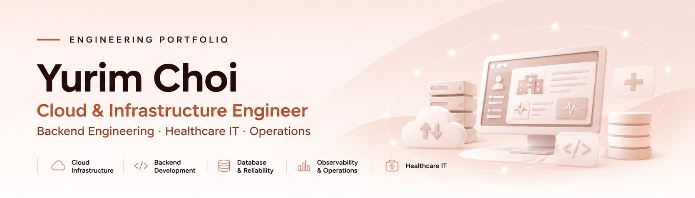
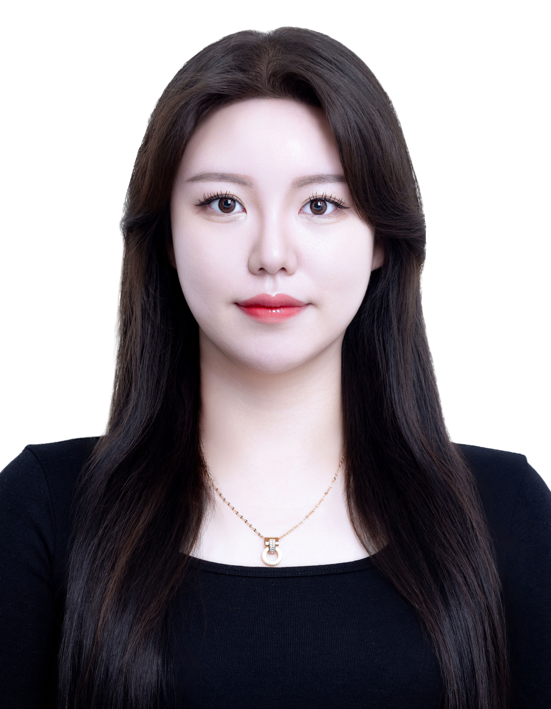
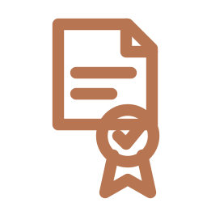
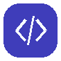

<!-- MAIN BANNER: 이미지와 본문은 별도로 유지 -->

<!-- ABOUT ME: GitHub README에서 코드 블록으로 표시되지 않도록 표 내부의 빈 줄을 사용하지 않음 -->
<table width="100%">
<tr>
<td width="20%" align="center" valign="middle">

</td>
<td width="80%" valign="middle">
<h3> &nbsp;About Me</h3>

<strong>현장과 기술을 연결하고, 개발부터 운영까지 생각하는 엔지니어</strong>

<blockquote>

병원 IT 환경에서 시스템 운영, 장애 대응, 사용자 요구사항 조율 및 기능 개선을 경험했으며, Backend 개발과 Cloud·Infrastructure 구축·배포까지 기술 영역을 확장해 왔습니다.

기술 자체보다 실제 문제를 해결하는 데 집중하며, 협업을 통해 요구사항과 설계 방향을 구체화하고 안정성·유지보수성·운영 효율성을 고려한 시스템을 지향합니다.

</blockquote>
</td>
</tr>
</table>

##  Quick Overview

| Focus | Summary |
| :--- | :--- |
|  **Career Direction** | Cloud & Infrastructure Engineering |
|  **Featured Project** | [BrainOn — AI-assisted Clinical Decision Support System](./sections/featured-project.md) |
|  **Professional Background** | [Healthcare IT Operations (약 3년)](./sections/professional-experience.md) |

---
##  Education & Training

- **2026.03 – 2026.10** — **건양대학교병원 바이오메디컬 인공지능 5기** · 수료
- **2025.09 – 현재** — **한국방송통신대학교** 컴퓨터과학과 · 휴학 중
- **2021.03 – 2022.02** — **원광보건대학교** 의무행정학과 · 학사 졸업
- **2017.03 – 2021.02** — **원광보건대학교** 의무행정과 · 전문학사 졸업

---

##  Featured Project

### BrainOn — AI-assisted Clinical Decision Support System

**AI 기반 뇌혈관질환 임상의사결정지원시스템(CDSS)**

의료진의 임상 Workflow에 의료영상 AI 분석, AI Assistant, 의약품 안전성 검증을 통합한 의료 AI 서비스 개발 프로젝트

- **Period:** Aug 2026 – Oct 2026
- **Team:** 3 Members
- **My Role:** Backend 개발·데이터베이스 연동, AI 서비스 연계, Cloud Infrastructure 구성·배포 및 E2E 통합 검증

  **[BrainOn 구현 내용 · 엔지니어링 기여 · 코드 증빙](./sections/featured-project.md)**

---

##  Professional Experience

**[↗ 기관별 담당 업무와 운영 경험 자세히 보기](./sections/professional-experience.md)**

| Organization | Position / Work | Period |
| :--- | :--- | :--- |
| **(주)시마인포텍 · 오송 베스티안병원** | IT Infrastructure & System Operations | 1년 2개월 |
| **익산병원 · 의료정보팀** | Healthcare IT Systems & Infrastructure Operations | 1년 9개월 |
| **서울아산병원 · 정보의학과** | Medical Research & Project Coordination | 4개월 |

---

##  Certifications

- **2021.03** — **보건의료정보관리사(의무기록사)**
- **2025.09** — **네트워크관리사 2급**
- **2021.03** — 병원행정사
- **2021.03** — 건강보험사
- **2025.09** — 영상정보관리사
- **2018.10** — 전산회계 2급

---
<!-- 기술 역량 상세 보기 -->
##  Technical Competencies

### Languages & Frameworks

   

### Database & Asynchronous Processing

   

### Cloud & Infrastructure

   

### AI & Service Integration

  

### Observability & Operations

   

### Collaboration & Tools

  

---

##  Projects & Contributions

[BrainOn CDSS](https://github.com/brainCDSS/BrainCDSS/tree/dev) · [Previous GitHub — choi-creator07](https://github.com/choi-creator07)

**[프로젝트 및 기여 링크 자세히 보기](./sections/projects-contributions.md)**
