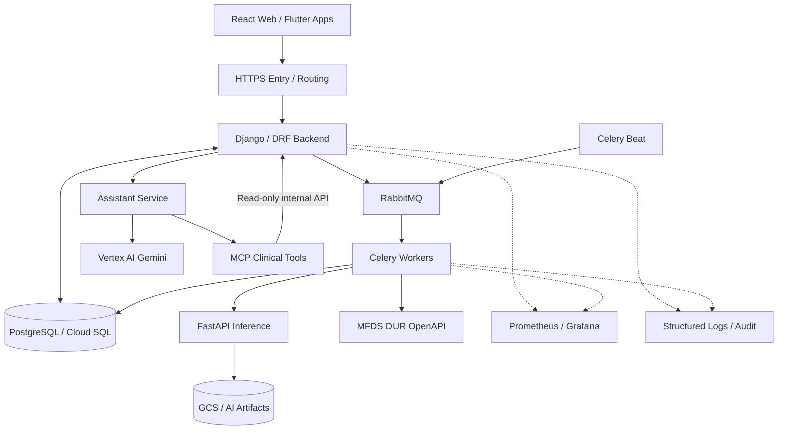

[← BrainOn Overview](../README.md) · [Portfolio Home](../../../README.md) · [Original Team Repository](https://github.com/brainCDSS/BrainCDSS/tree/dev)

## 02. System Architecture & Engineering Decisions

**Django를 임상 Workflow의 중심에 두고, 저장·비동기 작업·AI 서비스·운영 관측성의 책임을 분리**했습니다. 여기서의 아키텍처는 *서비스 간 논리적 연결*을 나타내며, 모든 서비스가 동일한 VPC 내부에 배포되었다는 뜻은 아닙니다.

| Design Decision | Reasoning |
| :--- | :--- |
| **Modular Monolith** | 도메인별 Service/API 경계를 분리하되 Django를 단일 Backend 진입점으로 유지 |
| **RabbitMQ + Celery** | HTTP 요청에서 장시간 추론·알림·외부 연동 작업 분리, 성격별 Queue 라우팅 |
| **PostgreSQL as Source of Truth** | 임상 데이터와 비동기 작업의 영속 상태를 DB에서 관리; Celery Result Backend 미사용 |
| **Separate AI Services** | 추론·Assistant를 Backend 외부 서비스로 분리하고 계약 기반으로 연계 |
| **Network & Access Control** | VPC 기반 서비스 접근 범위와 HTTPS 단일 진입점을 고려하고, 내부 통신·외부 API Egress 경로를 구분 |
| **Controlled Clinical Access** | MCP Tool의 DB 직접 접근을 제한하고 인증된 Django 내부 조회 API 사용 |
| **Traceability by Design** | HTTP·Celery·Assistant·Audit의 요청 식별자를 연결하여 장애 조사 경로 확보 |

<strong>View System Architecture — 전체 서비스 흐름도</strong>

> **Diagram scope:** 실제 연결 경로를 단순화한 *논리적 아키텍처*. HTTPS 진입점, VPC·Cloud Run·VM·Cloud SQL의 물리 배치 및 접근 정책은 배포 시점별 구성을 기준으로 별도 확인해야 합니다.

<strong>Architecture Decisions & Source Documents — 설계 근거</strong>

- [ADR-001 · Django Modular Monolith](https://github.com/brainCDSS/BrainCDSS/blob/dev/docs/decisions/ADR-001-modular-monolith.md)
- [ADR-003 · RabbitMQ / PostgreSQL responsibility](https://github.com/brainCDSS/BrainCDSS/blob/dev/docs/decisions/ADR-003-rabbitmq-without-redis.md)
- [RabbitMQ & Celery Queue Layout](https://github.com/brainCDSS/BrainCDSS/blob/dev/docs/CELERY_RABBITMQ_QUEUES.md)
- [AI Assistant & MCP Architecture](https://github.com/brainCDSS/BrainCDSS/blob/dev/docs/architecture/ai-assistant-and-mcp.md)
- [ADR-004 · MCP through Django Internal API](https://github.com/brainCDSS/BrainCDSS/blob/dev/docs/decisions/ADR-004-mcp-through-backend-api.md)

---

---

[← 01. 프로젝트 개요 및 개인 담당 범위](../01-overview/README.md) · [BrainOn 목차](../README.md) · [03. Backend 및 AI 서비스 통합 →](../03-backend-ai/README.md)
