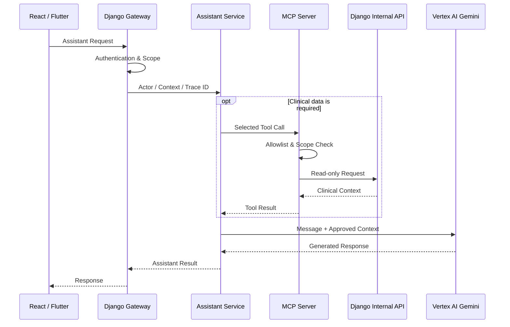

[← BrainOn Overview](../README.md) · [Portfolio Home](../../../README.md) · [Original Team Repository](https://github.com/brainCDSS/BrainCDSS/tree/dev)

## 03. Backend & AI Service Integration

임상 API, AI Assistant·MCP, 의료영상 AI 추론, DUR·Medication Safety를 Backend에서 연결했습니다. **구현 단위별 상세 흐름과 코드 근거는 아래 토글에서 확인할 수 있습니다.**

| Integration | Core Implementation |
| :--- | :--- |
| **Clinical Workflow** | 임상 도메인 API, Imaging/DICOM, Surgical Planning, 권한·상태·정합성 검증 |
| **Assistant & MCP** | 인증 기반 Gateway, 질문별 Tool 선택, 환자별 접근 범위 통제 |
| **AI Inference** | 모델·영상 입력 검증, Celery 비동기 요청, 결과·실패 상태 관리 |
| **Medication Safety** | DUR 기준정보 동기화, 처방 안전성 검사, CDS Hooks 연계 |

<strong>03.1 Clinical Backend — Imaging / Surgical Planning / Workflow</strong>

**구현 및 기여**

- 환자·진료(Encounter)·처방과 연계되는 임상 Workflow 및 도메인별 Django/DRF API 구현·통합.
- **Imaging:** 영상검사 처방·Study·History, DICOM 관련 Backend API, Viewer Session, Serializer·Permission·Selector·Service 구성 및 Orthanc Client 연계 구조 구현.
- **Surgical Planning:** 계획 생성·조회·수정, Clip 생성·변경·삭제, 협업 메시지 기능, 상태·버전 기반 수정 제어.
- Patient·Encounter·Imaging Study·AI Analysis의 관계 검증, 역할별 권한 검사, 확정/취소 상태의 수정 제한, 주요 변경 Audit 기록.
- 실제 구현 API가 Generated/Fallback API보다 우선 처리되도록 URL Routing 정리 및 FE·BE API 계약 조율.
- 사용자 권한·임상 도메인 간 상태·데이터 참조 관계를 함께 검증해 Frontend·Backend·AI 기능의 요청·응답 정합성을 확인.

**Why it matters** · 임상정보의 참조 관계와 상태를 유지하며 여러 화면과 서비스를 일관된 API 흐름으로 연결합니다.

**Code:** [Imaging API](https://github.com/brainCDSS/BrainCDSS/tree/dev/backend/apps/imaging/api) · [Surgical Planning Service](https://github.com/brainCDSS/BrainCDSS/blob/dev/backend/apps/surgical_planning/services/planning.py) · [Implementation Commit](https://github.com/brainCDSS/BrainCDSS/commit/4936efd42bf8e118b1e2c7bc3aeb70c9811a82e2)

<strong>03.2 AI Assistant & MCP — Context / Access Control / Trace</strong>

**Request flow**

**구현 및 기여**

- Django Gateway에서 인증 사용자를 기준으로 Actor·Role·`patient_scope`를 구성. 클라이언트가 보낸 역할·접근 범위를 그대로 신뢰하지 않도록 처리.
- **Patient Tools:** 환자 요약, 예약, 현재 복용약, 약물안전성 결과, 최근 검사, 영상 AI 결과, 의무기록 요약 조회.
- **Global Tools:** 오늘 예약 현황, 응급환자 Worklist, 미회신 협진 Worklist 조회.
- 질문에 필요한 Tool만 선택하는 **규칙 기반 MCP 라우팅** 구현; 일반 지식 질문에는 불필요한 임상 Tool 호출 생략.
- Patient Tool에는 `patient_id` 및 `patient_scope` 검증, Global Tool에는 별도 Role 검증 적용. MCP Registry와 Django Internal API 간 조회 전용 접근 경계 구성.
- 요청 흐름에서 `request_id`·`trace_id`를 일관되게 전달하여 Backend·Assistant·MCP 요청 추적 지원.

**Boundary:** MCP는 임상 DB에 직접 연결하거나 진단·처방 확정·기록 변경을 수행하지 않습니다. 

**Code:** [Django Gateway](https://github.com/brainCDSS/BrainCDSS/blob/dev/backend/apps/assistant/api/chat.py) · [Internal MCP API](https://github.com/brainCDSS/BrainCDSS/blob/dev/backend/apps/assistant/api/internal_mcp.py) · [MCP Client](https://github.com/brainCDSS/BrainCDSS/blob/dev/assistant-service/src/mcp-client/client.ts) · [Tool Registry](https://github.com/brainCDSS/BrainCDSS/blob/dev/mcp-server/src/tools/registry.py) · [Contribution Commit](https://github.com/brainCDSS/BrainCDSS/commit/a5460a939bcd73243b0a35377b2ba46ecff86ee9)

<strong>03.3 Medical AI Inference — Async Orchestration / Result Integration</strong>

- 분석 요청 시 영상검사 상태, 허용된 입력 NIfTI Artifact·Series, 승인된 모델 및 설정 정보를 검증.
- **Django → RabbitMQ/Celery → FastAPI Inference Service**로 장시간 작업을 분리하고, AI 추론 결과와 GCS Artifact를 임상 데이터 흐름에 연결.
- 분석 상태(`QUEUED`·`PROCESSING`·`RETRYING`·`COMPLETED`·`FAILED`), 작업 시도 이력, 재시도 가능한 오류, 결과 검증·저장 및 알림 연계.
- Cloud Run Inference 연계 설정·통합 및 FCM Web/Mobile 알림 변경사항을 팀 `dev`에 반영.

**My Contribution:** Backend에서 추론 요청·처리 상태·결과를 연결하는 서비스 통합을 담당했습니다.

**Code:** [Inference API](https://github.com/brainCDSS/BrainCDSS/blob/dev/backend/apps/ai_analysis/api/inference.py) · [Inference Celery Task](https://github.com/brainCDSS/BrainCDSS/blob/dev/backend/apps/ai_analysis/tasks/inference.py) · [PR #36](https://github.com/brainCDSS/BrainCDSS/pull/36)

<strong>03.4 DUR / Medication Safety / CDS Hooks — Clinical Safety Integration</strong>

- 식약처 **DUR OpenAPI** 연동, 외부 기준정보 조회·PostgreSQL Local DB 저장, 관리 Command·Service 및 Celery 정기 동기화 구조 구현.
- DUR 규칙 데이터 모델 및 활성화 정책 구성. 병용금기·용량주의·효능군중복·특정연령대금기·노인주의·임부금기·투여기간주의 관련 기준정보 구조 지원.
- 처방 안전성 검사에서 **DDI·DOSE·DUPLICATE·AGE·ELDERLY·PREGNANCY·DURATION·ALLERGY** 검사 경로와 약품·성분 Mapping 연계.
- **CDS Hooks:** `order-select`·`order-sign` 시점의 Medication Safety 검사, Discovery, `stroke-patient-view` 관련 API 및 서비스 인증 경계 구성.
- DUR 기준정보 저장·활성화, MEDM → Medication Safety E2E, 투여기간 허용/초과 경계값 검사 수행.

**Validation scope:** PR #35에 기록된 *실제 식약처 기준정보 수집·확인 범위*와 나머지 규칙의 **구조/검사 지원 범위**는 구분해야 합니다. 실제 OpenAPI 수집이 확인된 항목은 DDI(병용금기)·DOSE(용량주의)이며, 7종 전체가 운영 데이터로 검증되었다는 뜻은 아닙니다.

**Code:** [Medication Safety](https://github.com/brainCDSS/BrainCDSS/tree/dev/backend/apps/medication_safety) · [CDS Hooks API](https://github.com/brainCDSS/BrainCDSS/blob/dev/backend/apps/cdss/api/cds_hooks_views.py) · [DUR Sync Task](https://github.com/brainCDSS/BrainCDSS/blob/dev/backend/apps/medication_safety/tasks/dur_sync.py) · [PR #35](https://github.com/brainCDSS/BrainCDSS/pull/35)

---

---

[← 02. 시스템 아키텍처](../02-architecture/README.md) · [BrainOn 목차](../README.md) · [04. 데이터 정합성 및 비동기 처리 →](../04-data-async/README.md)
