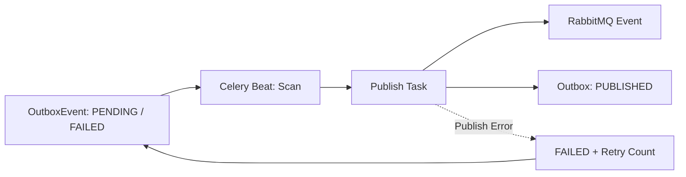

[← BrainOn Overview](../README.md) · [Portfolio Home](../../../README.md) · [Original Team Repository](https://github.com/brainCDSS/BrainCDSS/tree/dev)

## 04. Database, Asynchronous Processing & Reliability

**임상 데이터의 정합성**과 **장시간 작업의 분리·실패 복구**를 함께 고려했습니다. 업무 상태는 PostgreSQL에 보존하고, Queue와 Worker는 작업 실행을 담당하도록 역할을 분리했습니다.

| Concern | Implementation |
| :--- | :--- |
| **Data Integrity** | `transaction.atomic()` · Row Lock · Version Validation · Audit |
| **Async Workloads** | RabbitMQ · Celery Queues/Workers · Beat Schedule |
| **Event Processing** | PostgreSQL Outbox · Event Status · Retry |
| **Reliability** | Analysis State History · Attempt Tracking · Failure Code |

<strong>04.1 Database — Referential Integrity / Transaction / Concurrency</strong>

- Patient·Encounter·Imaging Study·AI Analysis·처방 등 도메인 데이터 관계 설계 및 PostgreSQL 연동.
- `transaction.atomic()`으로 관련 상태 변경과 상태 이력의 저장 범위를 관리.
- `select_for_update()`와 Version 검증으로 동시 수정 충돌·중복 수술계획 생성 제한.
- Surgical Planning에서 환자·영상검사·진료·AI 분석의 관계 검증, 확정·취소 상태 수정 제한, `409 Conflict` 처리.
- 수술계획 변경 전후 Audit 및 AI 분석 상태 전이 이력 기록. 관련 데이터 변경은 트랜잭션 범위 안에서 관리하고, 확정·취소 상태의 수정 제한 및 버전 불일치 시 `409 Conflict`를 반환.

**Code:** [Surgical Planning Transactional Service](https://github.com/brainCDSS/BrainCDSS/blob/dev/backend/apps/surgical_planning/services/planning.py) · [AI Analysis State Management](https://github.com/brainCDSS/BrainCDSS/blob/dev/backend/apps/ai_analysis/services/inference.py)

<strong>04.2 RabbitMQ / Celery — Queue Routing & Scheduled Jobs</strong>

| Queue | Responsibility |
| :--- | :--- |
| `brainon.inference` | 의료영상 AI 추론 Orchestration |
| `brainon.notifications` | 예약·복약·사용자 알림 |
| `brainon.integrations` | Outbox·외부 기준정보 동기화 |
| `brainon.default` | 기본·공통 작업 |

- AI 추론·알림·외부 연동을 HTTP Request에서 분리하고 작업 유형별 Queue로 라우팅.
- Celery Beat: **Outbox 발행 재점검 1분**, 예약 알림 확인 **10분**, 복약 알림 확인 **1분**, MFDS DUR 동기화 **매일 03:30(KST 설정 기준)**.
- Task 결과를 Celery Result Backend에 저장하지 않고 PostgreSQL 도메인 테이블에서 업무 상태를 관리. Worker는 실행을 담당하고, 지속 보존해야 하는 업무 상태는 도메인 DB에 기록.
- RabbitMQ Broker 연결 설정, Worker/Beat, Retry 및 Task 설정의 실행 환경 연계.

**Code:** [Queue Routing](https://github.com/brainCDSS/BrainCDSS/blob/dev/backend/config/celery_queues.py) · [Worker & Beat Settings](https://github.com/brainCDSS/BrainCDSS/blob/dev/backend/config/settings/base.py) · [Queue Layout](https://github.com/brainCDSS/BrainCDSS/blob/dev/docs/CELERY_RABBITMQ_QUEUES.md)

<strong>04.3 Outbox — Durable Event Status & Retry Flow</strong>

- PostgreSQL에 이벤트 Type·대상·Payload·상태·재시도 횟수 기록.
- 발행 Task에서 행 잠금(`select_for_update`) 후 RabbitMQ Topic Exchange에 메시지 발행, 성공 시 `PUBLISHED` 전환.
- 실패 시 `FAILED`·Retry Count 갱신, Celery Retry 및 Beat의 Pending/Failed 재발행 경로 마련.
- 행 잠금은 **동시 발행 시도 완화**에 기여하지만 Broker/DB 장애 경계를 포함한 *Exactly-once Delivery*를 보장하지는 않음.

**Code:** [Outbox Publishing & Retry](https://github.com/brainCDSS/BrainCDSS/blob/dev/backend/apps/common/outbox_tasks.py)

<strong>04.4 AI Task Reliability — State / Retry / Audit</strong>

- AI 분석 실행 전 상태 확인, Row Lock 및 분석 시도 횟수·Attempt 이력 기록.
- 재시도 가능한 추론 오류에 제한된 Celery Retry 적용; 성공 결과 검증 및 DB 저장.
- 최종 실패 시 Failure Code·AuditLog·의료진/관리자 알림 연결.
- 최초 HTTP 요청의 식별자를 Celery 작업 Header와 분석 Audit에 이어 전달하여 사건 단위 추적.
- 중복 전달 가능성에 대비해 현재 상태를 확인하는 처리로 불필요한 재실행 제한.

**Code:** [Celery Inference Task](https://github.com/brainCDSS/BrainCDSS/blob/dev/backend/apps/ai_analysis/tasks/inference.py) · [State Transition Service](https://github.com/brainCDSS/BrainCDSS/blob/dev/backend/apps/ai_analysis/services/inference.py)

---

---

[← 03. Backend 및 AI 서비스 통합](../03-backend-ai/README.md) · [BrainOn 목차](../README.md) · [05. Cloud 인프라 및 관측성 →](../05-cloud-observability/README.md)
