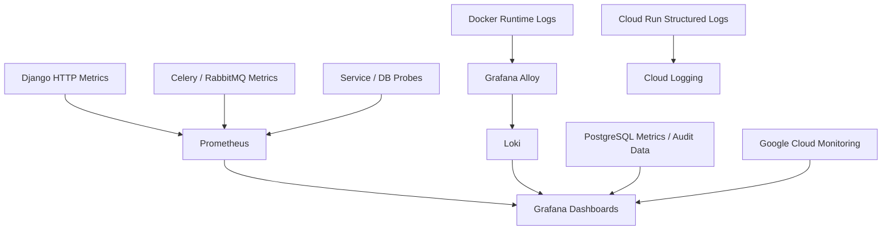

[← BrainOn Overview](../README.md) · [Portfolio Home](../../../README.md) · [Original Team Repository](https://github.com/brainCDSS/BrainCDSS/tree/dev)

## 05. Cloud Infrastructure & Observability

실행 환경이 서로 다른 Backend·Worker·DB·AI 서비스를 연결하는 **GCP 인프라 구성·서비스 배포·통합 검증을 수행**하고, 운영자가 문제를 파악할 수 있도록 **Metrics·Logs·Audit 관측성 환경을 구축**했습니다.

| Area | My Engineering Work |
| :--- | :--- |
| **Cloud Deployment** | Cloud Run·Compute Engine VM·Docker 환경의 서비스 배포·운영 설정 및 배포 후 통합 점검 |
| **Networking & Database** | VPC 통신 경로, Cloud SQL Private IP, 외부 API Egress·접근 조건 확인 |
| **Operational Visibility** | Prometheus·Loki·Alloy·Grafana Exporter·Dashboard·Data Source 구성 |
| **Tracing & Error Handling** | `request_id`·AuditLog·Structured Log·사용자 Tracking Code 연결 |

<strong>05.1 GCP Infrastructure — Runtime / Networking / Connectivity</strong>

| Component | Scope |
| :--- | :--- |
| **Cloud Run** | Backend 및 AI 관련 서비스의 배포 설정·연계와 연결 검증 |
| **VPC / Network** | 서비스 간 Private 경로·접근 설정 점검 및 통신 문제 분석 |
| **Cloud SQL (PostgreSQL)** | DB 리소스, Private IP 및 Backend/Worker 연결 구성·검증 |
| **Compute Engine VM** | RabbitMQ/Celery 및 운영 지원 서비스 실행 환경 구성·관리 |
| **HTTPS / Load Balancing** | 단일 서비스 진입점과 내부 요청 전달 구조 설계·구성 경험 |
| **Cloud NAT / External API** | 사설 네트워크에서 식약처 등 외부 API 호출 경로와 Egress 조건 점검 |
| **Docker** | 서비스별 컨테이너 구성·실행·배포·운영 점검 |

- Cloud Run·VM·Cloud SQL의 연결 경로를 구분해 애플리케이션 문제와 네트워크·인증 문제를 분리하여 점검.
- 내부 리소스 배치와 외부 API 호출을 구분하고, 운영환경 비용 및 리소스 구성도 점검·개선.
- 보안 설정과 서비스 구조는 작업 시점에 따라 변경되었으므로 **과거 Export 파일을 현재의 최종 배포 보안 상태로 해석하지 않음**.

**References:** [GCP Templates](https://github.com/brainCDSS/BrainCDSS/tree/dev/infra/gcp) · [Inference Deployment Guide](https://github.com/brainCDSS/BrainCDSS/blob/dev/docs/INFERENCE_CLOUD_RUN_DEPLOYMENT.md) · [Infrastructure Configuration](https://github.com/brainCDSS/BrainCDSS/tree/dev/infra)

<strong>05.2 Observability Pipeline — Prometheus / Alloy / Loki / Grafana</strong>

- **Prometheus:** Backend HTTP 상태·처리시간, RabbitMQ Queue, Celery Worker/Task 이벤트, 서비스 Health·DB 연결 지표 등 수집 구성.
- **Alloy → Loki:** Docker 런타임 로그를 수집·전달하는 경로와 로그 조회 환경 구성.
- **Grafana:** Prometheus·Loki·PostgreSQL·Google Cloud Monitoring Data Source 및 Overview·API·Async·AI·Infrastructure·Audit·Incidents 대시보드 구성. 실제 운영 DB와 AI 분석 상태, 사용자·트래픽·요청 흐름을 조회하는 관리자 관점의 지표와 화면 연계를 고려.
- **Cloud Run 로그:** 구조화된 stdout 로그는 Cloud Logging 경로로 처리. Docker→Loki 경로와 혼동하지 않도록 분리 표현.
- **Sensitive Data:** Route Template 기반 메트릭 Label, 요청 원문·Header·환자 식별정보를 불필요하게 로깅하지 않도록 작성한 처리 코드 활용. 전체 로그의 PHI 제거가 자동 보장되는 것은 아님.

**References:** [Prometheus](https://github.com/brainCDSS/BrainCDSS/blob/dev/infra/observability/prometheus/prometheus.yml) · [Alloy Pipeline](https://github.com/brainCDSS/BrainCDSS/blob/dev/infra/observability/alloy/config.alloy) · [Grafana Dashboards](https://github.com/brainCDSS/BrainCDSS/tree/dev/infra/observability/grafana/dashboards) · [Grafana Data Sources](https://github.com/brainCDSS/BrainCDSS/blob/dev/infra/observability/grafana/provisioning/datasources/brainon-runtime.yaml)

<strong>05.3 Operational Signals — 실제 수집 대상으로 구성한 지표</strong>

| Monitoring Domain | Signals |
| :--- | :--- |
| **Backend / API** | 요청 수·상태 클래스(2xx/4xx/5xx)·처리 시간 |
| **Celery / RabbitMQ** | Worker Online·Active/Pending Task·실패/재시도·Queue 상태 |
| **PostgreSQL** | DB 용량·연결 수·Transaction Commit/Rollback·Deadlock·Probe 상태 |
| **AI Analysis** | 분석 상태·작업 시도·추론 서비스 연결·결과 이력 |
| **Infrastructure** | 서비스 Health·응답 지연·의존성 연결 오류 |
| **Audit / Incidents** | Request Correlation·감사 이벤트·오류 Tracking Code |

- **핵심 판단:** HTTP `2xx`여도 하위 서비스 결과가 `FAILED`/`TIMEOUT`/`DEGRADED`일 수 있어, 응답 내부 의존성 상태를 별도 운영 지표·로그·Audit로 분류하는 로직 구현.
- Grafana 대시보드의 구성·코드 존재와 모든 지표의 실제 운영 시점 수집 성공을 같은 의미로 주장하지 않음.

**Code:** [HTTP Metrics](https://github.com/brainCDSS/BrainCDSS/blob/dev/backend/apps/common/http_metrics.py) · [Celery Exporter](https://github.com/brainCDSS/BrainCDSS/blob/dev/backend/apps/common/celery_metrics_exporter.py) · [Infrastructure Exporter](https://github.com/brainCDSS/BrainCDSS/blob/dev/backend/apps/common/infra_metrics_exporter.py) · [Dependency Observability](https://github.com/brainCDSS/BrainCDSS/blob/dev/backend/apps/common/dependency_observability.py)

<strong>05.4 Request Correlation — Audit / Tracking Code / Structured Logs</strong>

- `X-Request-ID`를 내부 Canonical Correlation ID로 사용하고, `X-Trace-ID`를 호환 식별자로 연계.
- HTTP 요청의 Route·Status·Duration 등을 구조화 로그로 남기며, 비동기 작업·Assistant·Audit에서 요청의 연관 관계 유지.
- 내부 UUID와 별개로 사용자에게 `ERR-` 형식의 **Tracking Code**를 표시하여 오류 문의 시 운영 추적에 활용.
- AuditLog의 Actor·Resource·Outcome·Request ID 및 변경 전후 데이터를 조회·검색하는 관리 기능 연계.
- 오류를 표시하는 사용자 UI와 실제 추적·원인 분석을 수행하는 운영 Backend 기능을 연결.

**Code:** [Correlation Middleware](https://github.com/brainCDSS/BrainCDSS/blob/dev/backend/apps/common/middleware.py) · [Tracking Code Helper](https://github.com/brainCDSS/BrainCDSS/blob/dev/backend/apps/common/tracking.py) · [Audit Trace Commit](https://github.com/brainCDSS/BrainCDSS/commit/4a9e70ece4b55258cab8541f555f3173bc829f53) · [Monitoring Commit](https://github.com/brainCDSS/BrainCDSS/commit/c54a26ddf0d123b52ae427902684b332005059a6)

---

---

[← 04. 데이터 정합성 및 비동기 처리](../04-data-async/README.md) · [BrainOn 목차](../README.md) · [06. 트러블슈팅 →](../06-troubleshooting/README.md)
