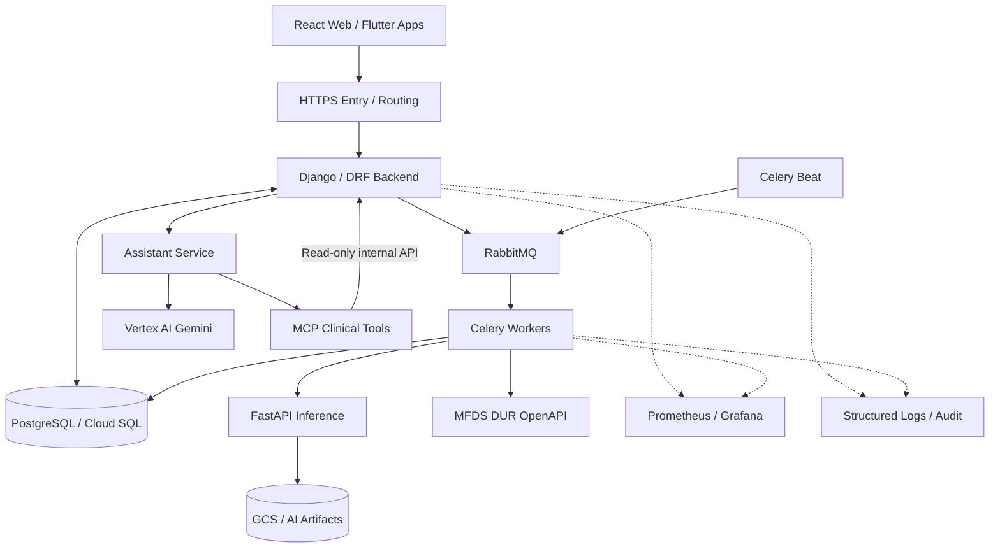
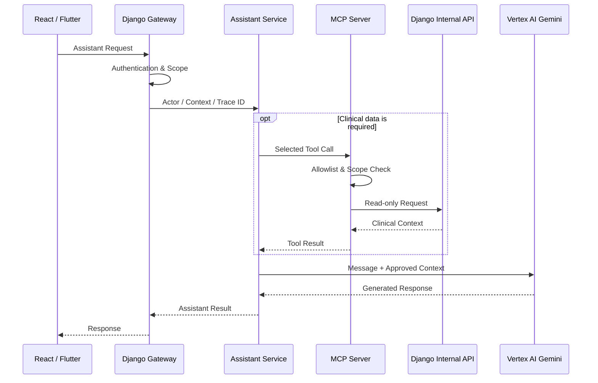
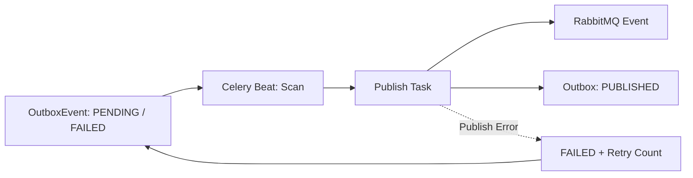
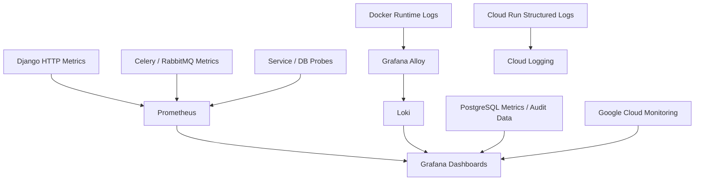

# BrainOn — Backend & Cloud Infrastructure Engineering

> AI 기반 뇌혈관질환 임상의사결정지원시스템(CDSS)
>
> Backend · AI Service Integration · Database · Cloud Infrastructure · Operations
> 3인 팀 프로젝트 | 2026.08–2026.10 (8 weeks)
> **[Original Team Repository](https://github.com/brainCDSS/BrainCDSS/tree/dev)**
>
> **Engineering Perspective**  
> 임상 업무와 AI 기능을 하나의 서비스로 연결하면서, 데이터 정합성·비동기 처리·접근 통제·운영 관측성을 함께 고려했습니다. 
> Backend 구현에서 Cloud Infrastructure 운영까지 이어지는 시스템 관점을 중심으로 기여했습니다.
---

### Contents

| | |
| :--- | :--- |
| [**01. Project Overview & My Role**](#01-project-overview--my-role) | 프로젝트 목적 · 담당 범위 |
| [**02. System Architecture & Engineering Decisions**](#02-system-architecture--engineering-decisions) | 서비스 구조 · 설계 판단 |
| [**03. Backend & AI Service Integration**](#03-backend--ai-service-integration) | 임상 API · MCP · AI 추론 · DUR |
| [**04. Database, Asynchronous Processing & Reliability**](#04-database-asynchronous-processing--reliability) | 정합성 · Queue · Outbox · 재시도 |
| [**05. Cloud Infrastructure & Observability**](#05-cloud-infrastructure--observability) | GCP · 네트워크 · Metrics · Logs |
| [**06. Engineering Challenges & Troubleshooting**](#06-engineering-challenges--troubleshooting) | 실제 문제 분석 및 해결 |
| [**07. Validation, Results & Code Contributions**](#07-validation-results--code-contributions) | 테스트 · PR · 직접 구현 Commit |

---

## 01. Project Overview & My Role

**BrainOn**은 뇌혈관질환 환자의 임상정보, 의료영상 AI 분석, 의약품 안전성 검증 및 AI Assistant를 하나의 진료 Workflow로 연결하는 임상의사결정지원시스템입니다. 분리된 기능과 데이터를 연계하고, 사용자 요청부터 데이터 처리·AI 분석·결과 확인까지 일관된 흐름으로 이어지는 서비스 구조를 구현하는 것을 목표로 했습니다. **요청 → 임상정보 처리 → AI 분석·안전성 검사 → 결과 확인**으로 이어지는 임상 Workflow를 지향했습니다.

### What I Owned

| Responsibility | My Contributions |
| :--- | :--- |
| **Backend & Clinical Workflow** | Django/DRF 기반 REST API·비즈니스 로직, Imaging/DICOM·Surgical Planning 연계 및 JWT/RBAC 공동 구현 |
| **Database & Data Integrity** | PostgreSQL 데이터 모델·관계 설계, 상태·트랜잭션·동시성 및 정합성 관리 |
| **Medication Safety** | 식약처 DUR OpenAPI, 기준정보 저장·동기화, Medication Safety·CDS Hooks 연계 |
| **AI Assistant & MCP** | Django Assistant Gateway, MCP Clinical Tool 및 Vertex AI Gemini 연계 경로 구성 |
| **AI Inference & Notifications** | FastAPI Inference 요청·결과 연계, Celery 작업 흐름 및 FCM Web/Mobile 알림 통합 |
| **Async Processing** | RabbitMQ/Celery Queue·Worker·Beat, Outbox 발행·정기 작업과 실패 처리 구성 |
| **Cloud Infrastructure & Deployment** | GCP VPC·Cloud Run·Cloud SQL·VM 환경 구성, 서비스 배포·운영 환경 통합 및 네트워크·DB·외부 API 연결 검증 수행 |
| **Observability & Traceability** | Grafana·Prometheus·Loki·Alloy, 운영 대시보드, `request_id`·AuditLog·오류 추적 체계 |
| **System Integration & E2E Validation** | FE·AI 담당자와 API 계약을 조율하고, 전체 서비스 연계·통합 테스트·E2E 검증·배포 후 점검·Git 병합 및 트러블슈팅 수행 |

> **My Role**  
> 3인 팀 프로젝트에서 Backend 개발과 클라우드 인프라 구성, 서비스 배포 및 통합·E2E 검증을 담당했습니다.

---

## 02. System Architecture & Engineering Decisions

**Django를 임상 Workflow의 중심에 두고, 저장·비동기 작업·AI 서비스·운영 관측성의 책임을 분리**했습니다. 여기서의 아키텍처는 *서비스 간 논리적 연결*을 나타내며, 모든 서비스가 동일한 VPC 내부에 배포되었다는 뜻은 아닙니다.

| Design Decision | Reasoning |
| :--- | :--- |
| **Modular Monolith** | 도메인별 Service/API 경계를 분리하되 Django를 단일 Backend 진입점으로 유지 |
| **RabbitMQ + Celery** | HTTP 요청에서 장시간 추론·알림·외부 연동 작업 분리, 성격별 Queue 라우팅 |
| **PostgreSQL as Source of Truth** | 임상 데이터와 비동기 작업의 영속 상태를 DB에서 관리; Celery Result Backend 미사용 |
| **Separate AI Services** | 추론·Assistant를 Backend 외부 서비스로 분리하고 계약 기반으로 연계 |
| **Network & Access Control** | VPC 기반 서비스 접근 범위와 HTTPS 단일 진입점을 고려하고, 내부 통신·외부 API Egress 경로를 구분 |
| **Controlled Clinical Access** | MCP Tool의 DB 직접 접근을 제한하고 인증된 Django 내부 조회 API 사용 |
| **Traceability by Design** | HTTP·Celery·Assistant·Audit의 요청 식별자를 연결하여 장애 조사 경로 확보 |

<strong>View System Architecture — 전체 서비스 흐름도</strong>

> **Diagram scope:** 실제 연결 경로를 단순화한 *논리적 아키텍처*. HTTPS 진입점, VPC·Cloud Run·VM·Cloud SQL의 물리 배치 및 접근 정책은 배포 시점별 구성을 기준으로 별도 확인해야 합니다.

<strong>Architecture Decisions & Source Documents — 설계 근거</strong>

- [ADR-001 · Django Modular Monolith](https://github.com/brainCDSS/BrainCDSS/blob/dev/docs/decisions/ADR-001-modular-monolith.md)
- [ADR-003 · RabbitMQ / PostgreSQL responsibility](https://github.com/brainCDSS/BrainCDSS/blob/dev/docs/decisions/ADR-003-rabbitmq-without-redis.md)
- [RabbitMQ & Celery Queue Layout](https://github.com/brainCDSS/BrainCDSS/blob/dev/docs/CELERY_RABBITMQ_QUEUES.md)
- [AI Assistant & MCP Architecture](https://github.com/brainCDSS/BrainCDSS/blob/dev/docs/architecture/ai-assistant-and-mcp.md)
- [ADR-004 · MCP through Django Internal API](https://github.com/brainCDSS/BrainCDSS/blob/dev/docs/decisions/ADR-004-mcp-through-backend-api.md)

---

## 03. Backend & AI Service Integration

임상 API, AI Assistant·MCP, 의료영상 AI 추론, DUR·Medication Safety를 Backend에서 연결했습니다. **구현 단위별 상세 흐름과 코드 근거는 아래 토글에서 확인할 수 있습니다.**

| Integration | Core Implementation |
| :--- | :--- |
| **Clinical Workflow** | 임상 도메인 API, Imaging/DICOM, Surgical Planning, 권한·상태·정합성 검증 |
| **Assistant & MCP** | 인증 기반 Gateway, 질문별 Tool 선택, 환자별 접근 범위 통제 |
| **AI Inference** | 모델·영상 입력 검증, Celery 비동기 요청, 결과·실패 상태 관리 |
| **Medication Safety** | DUR 기준정보 동기화, 처방 안전성 검사, CDS Hooks 연계 |

<strong>03.1 Clinical Backend — Imaging / Surgical Planning / Workflow</strong>

**구현 및 기여**

- 환자·진료(Encounter)·처방과 연계되는 임상 Workflow 및 도메인별 Django/DRF API 구현·통합.
- **Imaging:** 영상검사 처방·Study·History, DICOM 관련 Backend API, Viewer Session, Serializer·Permission·Selector·Service 구성 및 Orthanc Client 연계 구조 구현.
- **Surgical Planning:** 계획 생성·조회·수정, Clip 생성·변경·삭제, 협업 메시지 기능, 상태·버전 기반 수정 제어.
- Patient·Encounter·Imaging Study·AI Analysis의 관계 검증, 역할별 권한 검사, 확정/취소 상태의 수정 제한, 주요 변경 Audit 기록.
- 실제 구현 API가 Generated/Fallback API보다 우선 처리되도록 URL Routing 정리 및 FE·BE API 계약 조율.
- 사용자 권한·임상 도메인 간 상태·데이터 참조 관계를 함께 검증해 Frontend·Backend·AI 기능의 요청·응답 정합성을 확인.

**Why it matters** · 임상정보의 참조 관계와 상태를 유지하며 여러 화면과 서비스를 일관된 API 흐름으로 연결합니다.

**Code:** [Imaging API](https://github.com/brainCDSS/BrainCDSS/tree/dev/backend/apps/imaging/api) · [Surgical Planning Service](https://github.com/brainCDSS/BrainCDSS/blob/dev/backend/apps/surgical_planning/services/planning.py) · [Implementation Commit](https://github.com/brainCDSS/BrainCDSS/commit/4936efd42bf8e118b1e2c7bc3aeb70c9811a82e2)

<strong>03.2 AI Assistant & MCP — Context / Access Control / Trace</strong>

**Request flow**

**구현 및 기여**

- Django Gateway에서 인증 사용자를 기준으로 Actor·Role·`patient_scope`를 구성. 클라이언트가 보낸 역할·접근 범위를 그대로 신뢰하지 않도록 처리.
- **Patient Tools:** 환자 요약, 예약, 현재 복용약, 약물안전성 결과, 최근 검사, 영상 AI 결과, 의무기록 요약 조회.
- **Global Tools:** 오늘 예약 현황, 응급환자 Worklist, 미회신 협진 Worklist 조회.
- 질문에 필요한 Tool만 선택하는 **규칙 기반 MCP 라우팅** 구현; 일반 지식 질문에는 불필요한 임상 Tool 호출 생략.
- Patient Tool에는 `patient_id` 및 `patient_scope` 검증, Global Tool에는 별도 Role 검증 적용. MCP Registry와 Django Internal API 간 조회 전용 접근 경계 구성.
- 요청 흐름에서 `request_id`·`trace_id`를 일관되게 전달하여 Backend·Assistant·MCP 요청 추적 지원.

**Boundary:** MCP는 임상 DB에 직접 연결하거나 진단·처방 확정·기록 변경을 수행하지 않습니다. 

**Code:** [Django Gateway](https://github.com/brainCDSS/BrainCDSS/blob/dev/backend/apps/assistant/api/chat.py) · [Internal MCP API](https://github.com/brainCDSS/BrainCDSS/blob/dev/backend/apps/assistant/api/internal_mcp.py) · [MCP Client](https://github.com/brainCDSS/BrainCDSS/blob/dev/assistant-service/src/mcp-client/client.ts) · [Tool Registry](https://github.com/brainCDSS/BrainCDSS/blob/dev/mcp-server/src/tools/registry.py) · [Contribution Commit](https://github.com/brainCDSS/BrainCDSS/commit/a5460a939bcd73243b0a35377b2ba46ecff86ee9)

<strong>03.3 Medical AI Inference — Async Orchestration / Result Integration</strong>

- 분석 요청 시 영상검사 상태, 허용된 입력 NIfTI Artifact·Series, 승인된 모델 및 설정 정보를 검증.
- **Django → RabbitMQ/Celery → FastAPI Inference Service**로 장시간 작업을 분리하고, AI 추론 결과와 GCS Artifact를 임상 데이터 흐름에 연결.
- 분석 상태(`QUEUED`·`PROCESSING`·`RETRYING`·`COMPLETED`·`FAILED`), 작업 시도 이력, 재시도 가능한 오류, 결과 검증·저장 및 알림 연계.
- Cloud Run Inference 연계 설정·통합 및 FCM Web/Mobile 알림 변경사항을 팀 `dev`에 반영.

**My Contribution:** Backend에서 추론 요청·처리 상태·결과를 연결하는 서비스 통합을 담당했습니다.

**Code:** [Inference API](https://github.com/brainCDSS/BrainCDSS/blob/dev/backend/apps/ai_analysis/api/inference.py) · [Inference Celery Task](https://github.com/brainCDSS/BrainCDSS/blob/dev/backend/apps/ai_analysis/tasks/inference.py) · [PR #36](https://github.com/brainCDSS/BrainCDSS/pull/36)

<strong>03.4 DUR / Medication Safety / CDS Hooks — Clinical Safety Integration</strong>

- 식약처 **DUR OpenAPI** 연동, 외부 기준정보 조회·PostgreSQL Local DB 저장, 관리 Command·Service 및 Celery 정기 동기화 구조 구현.
- DUR 규칙 데이터 모델 및 활성화 정책 구성. 병용금기·용량주의·효능군중복·특정연령대금기·노인주의·임부금기·투여기간주의 관련 기준정보 구조 지원.
- 처방 안전성 검사에서 **DDI·DOSE·DUPLICATE·AGE·ELDERLY·PREGNANCY·DURATION·ALLERGY** 검사 경로와 약품·성분 Mapping 연계.
- **CDS Hooks:** `order-select`·`order-sign` 시점의 Medication Safety 검사, Discovery, `stroke-patient-view` 관련 API 및 서비스 인증 경계 구성.
- DUR 기준정보 저장·활성화, MEDM → Medication Safety E2E, 투여기간 허용/초과 경계값 검사 수행.

**Validation scope:** PR #35에 기록된 *실제 식약처 기준정보 수집·확인 범위*와 나머지 규칙의 **구조/검사 지원 범위**는 구분해야 합니다. 실제 OpenAPI 수집이 확인된 항목은 DDI(병용금기)·DOSE(용량주의)이며, 7종 전체가 운영 데이터로 검증되었다는 뜻은 아닙니다.

**Code:** [Medication Safety](https://github.com/brainCDSS/BrainCDSS/tree/dev/backend/apps/medication_safety) · [CDS Hooks API](https://github.com/brainCDSS/BrainCDSS/blob/dev/backend/apps/cdss/api/cds_hooks_views.py) · [DUR Sync Task](https://github.com/brainCDSS/BrainCDSS/blob/dev/backend/apps/medication_safety/tasks/dur_sync.py) · [PR #35](https://github.com/brainCDSS/BrainCDSS/pull/35)

---

## 04. Database, Asynchronous Processing & Reliability

**임상 데이터의 정합성**과 **장시간 작업의 분리·실패 복구**를 함께 고려했습니다. 업무 상태는 PostgreSQL에 보존하고, Queue와 Worker는 작업 실행을 담당하도록 역할을 분리했습니다.

| Concern | Implementation |
| :--- | :--- |
| **Data Integrity** | `transaction.atomic()` · Row Lock · Version Validation · Audit |
| **Async Workloads** | RabbitMQ · Celery Queues/Workers · Beat Schedule |
| **Event Processing** | PostgreSQL Outbox · Event Status · Retry |
| **Reliability** | Analysis State History · Attempt Tracking · Failure Code |

<strong>04.1 Database — Referential Integrity / Transaction / Concurrency</strong>

- Patient·Encounter·Imaging Study·AI Analysis·처방 등 도메인 데이터 관계 설계 및 PostgreSQL 연동.
- `transaction.atomic()`으로 관련 상태 변경과 상태 이력의 저장 범위를 관리.
- `select_for_update()`와 Version 검증으로 동시 수정 충돌·중복 수술계획 생성 제한.
- Surgical Planning에서 환자·영상검사·진료·AI 분석의 관계 검증, 확정·취소 상태 수정 제한, `409 Conflict` 처리.
- 수술계획 변경 전후 Audit 및 AI 분석 상태 전이 이력 기록. 관련 데이터 변경은 트랜잭션 범위 안에서 관리하고, 확정·취소 상태의 수정 제한 및 버전 불일치 시 `409 Conflict`를 반환.

**Code:** [Surgical Planning Transactional Service](https://github.com/brainCDSS/BrainCDSS/blob/dev/backend/apps/surgical_planning/services/planning.py) · [AI Analysis State Management](https://github.com/brainCDSS/BrainCDSS/blob/dev/backend/apps/ai_analysis/services/inference.py)

<strong>04.2 RabbitMQ / Celery — Queue Routing & Scheduled Jobs</strong>

| Queue | Responsibility |
| :--- | :--- |
| `brainon.inference` | 의료영상 AI 추론 Orchestration |
| `brainon.notifications` | 예약·복약·사용자 알림 |
| `brainon.integrations` | Outbox·외부 기준정보 동기화 |
| `brainon.default` | 기본·공통 작업 |

- AI 추론·알림·외부 연동을 HTTP Request에서 분리하고 작업 유형별 Queue로 라우팅.
- Celery Beat: **Outbox 발행 재점검 1분**, 예약 알림 확인 **10분**, 복약 알림 확인 **1분**, MFDS DUR 동기화 **매일 03:30(KST 설정 기준)**.
- Task 결과를 Celery Result Backend에 저장하지 않고 PostgreSQL 도메인 테이블에서 업무 상태를 관리. Worker는 실행을 담당하고, 지속 보존해야 하는 업무 상태는 도메인 DB에 기록.
- RabbitMQ Broker 연결 설정, Worker/Beat, Retry 및 Task 설정의 실행 환경 연계.

**Code:** [Queue Routing](https://github.com/brainCDSS/BrainCDSS/blob/dev/backend/config/celery_queues.py) · [Worker & Beat Settings](https://github.com/brainCDSS/BrainCDSS/blob/dev/backend/config/settings/base.py) · [Queue Layout](https://github.com/brainCDSS/BrainCDSS/blob/dev/docs/CELERY_RABBITMQ_QUEUES.md)

<strong>04.3 Outbox — Durable Event Status & Retry Flow</strong>

- PostgreSQL에 이벤트 Type·대상·Payload·상태·재시도 횟수 기록.
- 발행 Task에서 행 잠금(`select_for_update`) 후 RabbitMQ Topic Exchange에 메시지 발행, 성공 시 `PUBLISHED` 전환.
- 실패 시 `FAILED`·Retry Count 갱신, Celery Retry 및 Beat의 Pending/Failed 재발행 경로 마련.
- 행 잠금은 **동시 발행 시도 완화**에 기여하지만 Broker/DB 장애 경계를 포함한 *Exactly-once Delivery*를 보장하지는 않음.

**Code:** [Outbox Publishing & Retry](https://github.com/brainCDSS/BrainCDSS/blob/dev/backend/apps/common/outbox_tasks.py)

<strong>04.4 AI Task Reliability — State / Retry / Audit</strong>

- AI 분석 실행 전 상태 확인, Row Lock 및 분석 시도 횟수·Attempt 이력 기록.
- 재시도 가능한 추론 오류에 제한된 Celery Retry 적용; 성공 결과 검증 및 DB 저장.
- 최종 실패 시 Failure Code·AuditLog·의료진/관리자 알림 연결.
- 최초 HTTP 요청의 식별자를 Celery 작업 Header와 분석 Audit에 이어 전달하여 사건 단위 추적.
- 중복 전달 가능성에 대비해 현재 상태를 확인하는 처리로 불필요한 재실행 제한.

**Code:** [Celery Inference Task](https://github.com/brainCDSS/BrainCDSS/blob/dev/backend/apps/ai_analysis/tasks/inference.py) · [State Transition Service](https://github.com/brainCDSS/BrainCDSS/blob/dev/backend/apps/ai_analysis/services/inference.py)

---

## 05. Cloud Infrastructure & Observability

실행 환경이 서로 다른 Backend·Worker·DB·AI 서비스를 연결하는 **GCP 인프라 구성·서비스 배포·통합 검증을 수행**하고, 운영자가 문제를 파악할 수 있도록 **Metrics·Logs·Audit 관측성 환경을 구축**했습니다.

| Area | My Engineering Work |
| :--- | :--- |
| **Cloud Deployment** | Cloud Run·Compute Engine VM·Docker 환경의 서비스 배포·운영 설정 및 배포 후 통합 점검 |
| **Networking & Database** | VPC 통신 경로, Cloud SQL Private IP, 외부 API Egress·접근 조건 확인 |
| **Operational Visibility** | Prometheus·Loki·Alloy·Grafana Exporter·Dashboard·Data Source 구성 |
| **Tracing & Error Handling** | `request_id`·AuditLog·Structured Log·사용자 Tracking Code 연결 |

<strong>05.1 GCP Infrastructure — Runtime / Networking / Connectivity</strong>

| Component | Scope |
| :--- | :--- |
| **Cloud Run** | Backend 및 AI 관련 서비스의 배포 설정·연계와 연결 검증 |
| **VPC / Network** | 서비스 간 Private 경로·접근 설정 점검 및 통신 문제 분석 |
| **Cloud SQL (PostgreSQL)** | DB 리소스, Private IP 및 Backend/Worker 연결 구성·검증 |
| **Compute Engine VM** | RabbitMQ/Celery 및 운영 지원 서비스 실행 환경 구성·관리 |
| **HTTPS / Load Balancing** | 단일 서비스 진입점과 내부 요청 전달 구조 설계·구성 경험 |
| **Cloud NAT / External API** | 사설 네트워크에서 식약처 등 외부 API 호출 경로와 Egress 조건 점검 |
| **Docker** | 서비스별 컨테이너 구성·실행·배포·운영 점검 |

- Cloud Run·VM·Cloud SQL의 연결 경로를 구분해 애플리케이션 문제와 네트워크·인증 문제를 분리하여 점검.
- 내부 리소스 배치와 외부 API 호출을 구분하고, 운영환경 비용 및 리소스 구성도 점검·개선.
- 보안 설정과 서비스 구조는 작업 시점에 따라 변경되었으므로 **과거 Export 파일을 현재의 최종 배포 보안 상태로 해석하지 않음**.

**References:** [GCP Templates](https://github.com/brainCDSS/BrainCDSS/tree/dev/infra/gcp) · [Inference Deployment Guide](https://github.com/brainCDSS/BrainCDSS/blob/dev/docs/INFERENCE_CLOUD_RUN_DEPLOYMENT.md) · [Infrastructure Configuration](https://github.com/brainCDSS/BrainCDSS/tree/dev/infra)

<strong>05.2 Observability Pipeline — Prometheus / Alloy / Loki / Grafana</strong>

- **Prometheus:** Backend HTTP 상태·처리시간, RabbitMQ Queue, Celery Worker/Task 이벤트, 서비스 Health·DB 연결 지표 등 수집 구성.
- **Alloy → Loki:** Docker 런타임 로그를 수집·전달하는 경로와 로그 조회 환경 구성.
- **Grafana:** Prometheus·Loki·PostgreSQL·Google Cloud Monitoring Data Source 및 Overview·API·Async·AI·Infrastructure·Audit·Incidents 대시보드 구성. 실제 운영 DB와 AI 분석 상태, 사용자·트래픽·요청 흐름을 조회하는 관리자 관점의 지표와 화면 연계를 고려.
- **Cloud Run 로그:** 구조화된 stdout 로그는 Cloud Logging 경로로 처리. Docker→Loki 경로와 혼동하지 않도록 분리 표현.
- **Sensitive Data:** Route Template 기반 메트릭 Label, 요청 원문·Header·환자 식별정보를 불필요하게 로깅하지 않도록 작성한 처리 코드 활용. 전체 로그의 PHI 제거가 자동 보장되는 것은 아님.

**References:** [Prometheus](https://github.com/brainCDSS/BrainCDSS/blob/dev/infra/observability/prometheus/prometheus.yml) · [Alloy Pipeline](https://github.com/brainCDSS/BrainCDSS/blob/dev/infra/observability/alloy/config.alloy) · [Grafana Dashboards](https://github.com/brainCDSS/BrainCDSS/tree/dev/infra/observability/grafana/dashboards) · [Grafana Data Sources](https://github.com/brainCDSS/BrainCDSS/blob/dev/infra/observability/grafana/provisioning/datasources/brainon-runtime.yaml)

<strong>05.3 Operational Signals — 실제 수집 대상으로 구성한 지표</strong>

| Monitoring Domain | Signals |
| :--- | :--- |
| **Backend / API** | 요청 수·상태 클래스(2xx/4xx/5xx)·처리 시간 |
| **Celery / RabbitMQ** | Worker Online·Active/Pending Task·실패/재시도·Queue 상태 |
| **PostgreSQL** | DB 용량·연결 수·Transaction Commit/Rollback·Deadlock·Probe 상태 |
| **AI Analysis** | 분석 상태·작업 시도·추론 서비스 연결·결과 이력 |
| **Infrastructure** | 서비스 Health·응답 지연·의존성 연결 오류 |
| **Audit / Incidents** | Request Correlation·감사 이벤트·오류 Tracking Code |

- **핵심 판단:** HTTP `2xx`여도 하위 서비스 결과가 `FAILED`/`TIMEOUT`/`DEGRADED`일 수 있어, 응답 내부 의존성 상태를 별도 운영 지표·로그·Audit로 분류하는 로직 구현.
- Grafana 대시보드의 구성·코드 존재와 모든 지표의 실제 운영 시점 수집 성공을 같은 의미로 주장하지 않음.

**Code:** [HTTP Metrics](https://github.com/brainCDSS/BrainCDSS/blob/dev/backend/apps/common/http_metrics.py) · [Celery Exporter](https://github.com/brainCDSS/BrainCDSS/blob/dev/backend/apps/common/celery_metrics_exporter.py) · [Infrastructure Exporter](https://github.com/brainCDSS/BrainCDSS/blob/dev/backend/apps/common/infra_metrics_exporter.py) · [Dependency Observability](https://github.com/brainCDSS/BrainCDSS/blob/dev/backend/apps/common/dependency_observability.py)

<strong>05.4 Request Correlation — Audit / Tracking Code / Structured Logs</strong>

- `X-Request-ID`를 내부 Canonical Correlation ID로 사용하고, `X-Trace-ID`를 호환 식별자로 연계.
- HTTP 요청의 Route·Status·Duration 등을 구조화 로그로 남기며, 비동기 작업·Assistant·Audit에서 요청의 연관 관계 유지.
- 내부 UUID와 별개로 사용자에게 `ERR-` 형식의 **Tracking Code**를 표시하여 오류 문의 시 운영 추적에 활용.
- AuditLog의 Actor·Resource·Outcome·Request ID 및 변경 전후 데이터를 조회·검색하는 관리 기능 연계.
- 오류를 표시하는 사용자 UI와 실제 추적·원인 분석을 수행하는 운영 Backend 기능을 연결.

**Code:** [Correlation Middleware](https://github.com/brainCDSS/BrainCDSS/blob/dev/backend/apps/common/middleware.py) · [Tracking Code Helper](https://github.com/brainCDSS/BrainCDSS/blob/dev/backend/apps/common/tracking.py) · [Audit Trace Commit](https://github.com/brainCDSS/BrainCDSS/commit/4a9e70ece4b55258cab8541f555f3173bc829f53) · [Monitoring Commit](https://github.com/brainCDSS/BrainCDSS/commit/c54a26ddf0d123b52ae427902684b332005059a6)

---

## 06. Engineering Challenges & Troubleshooting

BrainOn 개발 과정에서는 Backend 기능 구현뿐 아니라 클라우드 네트워크 연결, 서비스 간 API 통합, AI Assistant의 접근 제어 및 운영 장애 추적과 관련된 문제를 해결해야 했습니다.

문제를 단편적으로 수정하기보다 **원인 분석 → 영향 범위 파악 → 구조적 개선 → 검증** 과정을 중심으로 접근했습니다. 다음 사례는 실제 충돌 해결, 설계 제약 개선, 운영 관측성 보강을 구분하여 정리했습니다.

| Case | Challenge / Engineering Response |
| :--- | :--- |
| **Cloud Connectivity** | VPC·Cloud Run·VM·Cloud SQL 통신 경로와 접근·Egress 조건 분석 |
| **Merge & API Routing** | 병렬 개발 충돌 해결, Generated API와 실제 구현 API 우선순위 정리 |
| **MCP Context** | 환자 미선택 질문 허용과 환자별 접근 제어 유지 |
| **Error Tracking** | 내부 UUID와 사용자용 Tracking Code 분리, 로그·감사 기록 연계 |
| **Partial Failures** | HTTP 성공 응답 속 의존성 오류를 별도 운영 신호로 분류 |

<strong>Case 01 · Cloud / VPC 서비스 통신 분석</strong>

**Challenge: 클라우드 환경에서 서비스 간 통신 경로 구성 및 연결 문제 분석**

**Problem**

- Backend, RabbitMQ/Celery, Cloud SQL 및 AI 서비스가 서로 다른 GCP 실행 환경에서 동작
- 비공개 네트워크 구성을 추진하면서 서비스 간 통신 경로와 접근 정책을 구분하여 점검해야 하는 문제 발생

**Investigation & Approach**

- Cloud Run의 VPC Egress 및 서비스 접근 설정 확인
- Compute Engine VM의 내부 IP, 서비스 포트 및 네트워크 연결 상태 점검
- Cloud SQL의 Public/Private IP 구성과 Private Service Access 연결 조건 검토
- 내부 통신과 외부 API 호출을 구분하여 네트워크 경로 및 인증 조건 확인
- Cloud NAT의 Outbound 조건과 VM·Cloud SQL 연결 경로를 서비스별로 나누어 점검

**Engineering Outcome**

- 서비스별 네트워크 의존성과 통신 경로를 구분하여 인프라 구성 및 연결 검증 진행
- 애플리케이션 오류와 네트워크·접근 정책 문제를 별도로 분석할 수 있도록 점검 범위 정리

**Key Learning:** Cloud 환경에서는 서비스가 실행 중인 상태와 다른 서비스에서 정상적으로 접근할 수 있는 상태를 구분해야 하며, 네트워크 경로·인증·접근 정책을 함께 확인하는 것이 중요합니다.

> VPC 내부 통신과 외부 API 연결은 실제 구성 시점에 따라 달라졌습니다. 최종 통신 검증 기록이 확인되지 않은 경로는 완전한 비공개 운영 또는 장애 해결 완료로 단정하지 않았습니다.

<strong>Case 02 · Surgical Planning Merge Conflict & API Routing 해결</strong>

**Challenge: 병렬 개발 과정의 Git 충돌과 API Routing 정합성 문제 해결**

**Problem**

- 팀원별 기능 개발 이후 최신 `dev` 브랜치를 통합하는 과정에서 Surgical Planning 관련 Backend 코드 충돌 발생
- 실제 구현한 API와 기존 Generated/Fallback API가 공존하여 Routing 우선순위 정리 필요

**Root Cause & Analysis**

- 병렬 개발로 동일한 Serializer, View, Service 및 URL 설정 파일이 변경됨
- 기존 자동 생성 API와 실제 구현 API 간의 호출 경로를 명확하게 구분해야 했음

**Resolution**

- 최신 `dev` 변경사항을 개인 작업 브랜치에 반영하고 충돌 파일별 구현 내용 비교
- 검증된 Surgical Planning Backend 구현을 기준으로 충돌 해결
- `config/urls.py`에서 실제 구현 API가 Generated/Fallback API보다 우선 적용되도록 Routing 정리
- 전체 변경사항의 정합성을 확인한 후 통합 PR 생성

**Validation**

- Django System Check 정상
- Migration 누락 검사 정상
- DUR·Medication Safety 관련 Regression Test 15개 통과 (Surgical Planning 테스트 15개라는 의미는 아님)
- Medication Safety E2E 및 Surgical Planning 변경사항 검증
- 통합 PR 병합 완료

**Evidence**
- [PR #35 — Backend Integration & Merge Conflict Resolution](https://github.com/brainCDSS/BrainCDSS/pull/35)
- [Surgical Planning Implementation](https://github.com/brainCDSS/BrainCDSS/commit/4936efd42bf8e118b1e2c7bc3aeb70c9811a82e2)

**Key Learning:** Git 충돌 해결은 단순히 변경 내용을 병합하는 작업이 아니라, 기능 계약과 실제 API 동작을 유지하면서 팀 전체 코드를 통합하는 검증 과정입니다.

<strong>Case 03 · MCP Patient / Global Context 제약 개선</strong>

**Challenge: 환자 미선택 질문과 환자별 임상정보 조회의 처리 조건 충돌**

**Problem**

- 초기 Assistant 요청 구조에서는 `patient_id`와 환자 접근 범위를 요구
- 특정 환자와 무관한 일반 질문이나 전체 업무 현황 조회에도 환자 Context가 필요해지는 제약 발생
- 환자 미선택 질문을 허용하더라도 기존 임상정보 접근 통제는 유지해야 했음

**Root Cause & Analysis**

- Patient Tool과 Global Tool의 입력 조건이 구분되지 않은 요청 구조
- 환자별 조회에 필요한 접근 검증을 모든 질문에 동일하게 적용한 것이 문제

**Resolution**

- Patient Tool과 Global Tool을 구분하여 요청 Context 구조 개선
- 환자 미선택 일반 질문에서는 `patient_id` 없이 처리할 수 있도록 변경
- 질문에 필요한 MCP Tool만 선택적으로 호출하도록 로직 구성
- Patient Tool 사용 시 환자 식별자와 `patient_scope` 검증 유지
- MCP Registry에서도 허용된 Tool 및 접근 범위를 재검증
- Patient Tool에는 환자 ID가 필요하고 Global Tool에는 역할 검증이 필요하다는 조건을 분리

**Verification**

- 환자 Context가 필요한 질문과 필요하지 않은 질문의 처리 흐름 분리
- 일반 질문에서 불필요한 MCP 호출을 방지하는 로직 구현
- Patient Tool의 접근 범위 검증을 유지하고 관련 테스트 코드 추가

**Evidence**
- [MCP Routing & Request Tracking — Commit](https://github.com/brainCDSS/BrainCDSS/commit/a5460a939bcd73243b0a35377b2ba46ecff86ee9)
- [Assistant Chat Flow](https://github.com/brainCDSS/BrainCDSS/blob/dev/assistant-service/src/flows/chat.ts)
- [MCP Tool Registry](https://github.com/brainCDSS/BrainCDSS/blob/dev/mcp-server/src/tools/registry.py)

**Key Learning:** AI 서비스에서는 기능 확장뿐 아니라 요청의 맥락과 데이터 접근 범위를 분리하여, 사용성과 보안 조건을 동시에 유지하는 설계가 중요합니다.

<strong>Case 04 · User-facing Error Code와 내부 Audit Trace 분리</strong>

**Challenge: 사용자 오류 표시와 내부 요청 추적 식별자 분리**

**Problem**

- UUID 기반 `request_id`는 내부 요청 추적에 적합하지만 사용자에게 그대로 표시하기에는 가독성이 낮음
- HTTP 요청, 오류 응답, AuditLog 및 비동기 작업 간 연관 관계를 유지해야 함

**Analysis & Resolution**

- 내부 추적을 위한 `request_id`를 기준 식별자로 유지
- 사용자에게 표시할 별도의 `ERR-` 형식 Tracking Code 구성 (내부 `request_id`는 기준 식별자로 유지)
- 오류 응답 및 HTTP Header에 추적 정보를 연결
- 구조화 요청 로그에 서비스·Route·응답 상태·처리시간 및 요청 식별자 기록
- AuditLog 조회 및 운영 화면에서 요청 식별자를 활용할 수 있도록 연계

**Engineering Outcome**

- 사용자용 오류 코드와 시스템 내부 추적 식별자의 역할 분리
- 운영자가 오류 문의와 관련 요청·감사 정보를 연결하여 확인할 수 있는 코드 구조 구현
- 원본 UUID를 기준으로 서비스 요청의 연관 관계 유지

**Evidence**
- [Request Tracking Middleware](https://github.com/brainCDSS/BrainCDSS/blob/dev/backend/apps/common/middleware.py)
- [Tracking Code Implementation](https://github.com/brainCDSS/BrainCDSS/blob/dev/backend/apps/common/tracking.py)
- [Audit Request Tracking — Commit](https://github.com/brainCDSS/BrainCDSS/commit/4a9e70ece4b55258cab8541f555f3173bc829f53)

**Key Learning:** 장애 대응을 고려한 시스템에서는 로그를 남기는 것뿐 아니라, 사용자가 전달한 오류 정보로 관련 요청과 처리 이력을 찾을 수 있는 구조가 필요합니다.

<strong>Case 05 · HTTP 2xx에 가려진 하위 서비스 오류 관측</strong>

**Challenge: HTTP 성공 응답만으로 확인하기 어려운 내부 의존성 오류**

**Problem**

- HTTP 응답이 `2xx`여도 응답 내부의 외부 연동 또는 하위 서비스 처리 결과는 실패·지연·성능 저하 상태일 수 있음
- 단순 HTTP 상태 코드 모니터링만으로는 이러한 부분 실패를 식별하기 어려움

**Engineering Approach**

- 내부 의존성의 응답 상태를 별도로 판단하는 관측성 로직 구성
- `FAILED`, `TIMEOUT`, `DEGRADED`, `PARTIAL_FAILURE` 등 상태를 운영 신호로 분류
- Prometheus Counter, 구조화 Warning Log 및 `DEPENDENCY_DEGRADED` Audit 이벤트로 관련 상황을 기록하도록 구현
- API·비동기·인프라·감사 추적 대시보드를 구분하여 운영 지표 시각화

**Engineering Outcome**

- HTTP 응답 성공 여부와 내부 의존성 상태를 별도로 관측할 수 있는 코드 구조 마련
- 서비스 장애 및 부분 실패를 분석할 수 있도록 Metrics·Logs·Audit 정보 연계

**Evidence**
- [Dependency Observability Implementation](https://github.com/brainCDSS/BrainCDSS/blob/dev/backend/apps/common/dependency_observability.py)
- [Operations Monitoring & Error Tracing — Commit](https://github.com/brainCDSS/BrainCDSS/commit/c54a26ddf0d123b52ae427902684b332005059a6)

**Key Learning:** 서비스의 정상 동작 여부는 HTTP 응답 코드 하나로 판단하기 어렵습니다. 내부 의존성·작업 상태·로그를 함께 관측할 수 있어야 장애 원인을 보다 정확하게 분석할 수 있습니다.

### Engineering Takeaways

프로젝트를 통해 기능 구현과 시스템 운영을 별개의 작업으로 보지 않고, 설계 단계부터 데이터 흐름·통신 경로·실패 상황·추적 가능성을 함께 고려하는 경험을 쌓았습니다.

특히 Backend 기능을 구현하는 과정에서 Cloud Infrastructure, 비동기 작업, AI 서비스 연계 및 운영 모니터링까지 연결하여 **개발과 운영을 함께 이해하는 엔지니어링 관점**을 발전시켰습니다.

---

## 07. Validation, Results & Code Contributions

**구현 결과는 코드와 검증 기록을 함께 제시**합니다. 개인 작성 Commit과 팀 통합 PR, 해당 시점의 테스트 결과를 구분하고, 전체 서비스 통합·배포 및 E2E 검증을 수행한 범위를 명시했습니다.

| Evidence | Verified Record |
| :--- | :--- |
| **Merged Pull Requests** | [PR #35 — Clinical Backend](https://github.com/brainCDSS/BrainCDSS/pull/35) · [PR #36 — AI/MCP/Inference](https://github.com/brainCDSS/BrainCDSS/pull/36) |
| **Backend / Medication Safety** | PR #35에 기록된 관련 Regression Test **15개 PASS** 및 E2E 검증 |
| **Integration Checks** | 통합·E2E 검증을 중심으로 직접 수행; PR #35 Django/Migration 검증, PR #36 Django Check·Frontend Test/Build·Compose Check 기록 |
| **Personal Commit Evidence** | Imaging·Surgical Planning / MCP / Observability / Audit 관련 개인 작성 Commit |
| **Validation Ownership** | Backend·AI·Frontend 연결, 배포 설정 및 전체 서비스 통합·E2E 검증 수행 |

### Selected Code Contributions

| Contribution | Direct Commit |
| :--- | :--- |
| **Clinical Backend · Imaging · Surgical Planning** | [Implementation & Routing](https://github.com/brainCDSS/BrainCDSS/commit/4936efd42bf8e118b1e2c7bc3aeb70c9811a82e2) |
| **AI Assistant · MCP · Context / Trace** | [MCP Routing & Request Correlation](https://github.com/brainCDSS/BrainCDSS/commit/a5460a939bcd73243b0a35377b2ba46ecff86ee9) |
| **Observability · Grafana · Error Tracking** | [Operations Monitoring & Dashboards](https://github.com/brainCDSS/BrainCDSS/commit/c54a26ddf0d123b52ae427902684b332005059a6) |
| **AuditLog · HTTP Request Tracking** | [Audit Tracking / Error Handling](https://github.com/brainCDSS/BrainCDSS/commit/4a9e70ece4b55258cab8541f555f3173bc829f53) |

<strong>07.1 Validation Details — PR #35 / PR #36</strong>

**PR #35 · Clinical Backend Integration**  
`choi-creator98` 작성 · `dev` 병합 · 2026-09-11 (UTC)

- Django System Check 정상: `python manage.py check`
- Migration 누락 검사 정상: `python manage.py makemigrations --check --dry-run`
- DUR Duration Rule Migration 적용 확인
- DUR·Medication Safety 관련 Regression Test **15개 PASS**
- MFDS DUR 응답·Local DB 저장·규칙 활성화, MEDM → Medication Safety E2E 확인
- 투여기간 경계값: 허용 범위 정상 / 초과 시 `DURATION / MAJOR` Alert 검증
- Surgical Planning 충돌 해결 및 Backend 코드 점검; `git diff --check` 정상
- [Source: PR #35](https://github.com/brainCDSS/BrainCDSS/pull/35)

**PR #36 · Assistant / MCP / Inference Integration**  
`choi-creator98` 작성 · `dev` 병합 · 2026-09-13 (UTC)

- FCM Web/Mobile, Assistant+MCP, Cloud Run Inference 연계 변경사항 통합
- PR 기록 기준 Django Check, Frontend Test, Frontend Build 및 Docker Compose Config 검증
- [Source: PR #36](https://github.com/brainCDSS/BrainCDSS/pull/36)

> 위 결과는 해당 PR 작업 당시의 검증 기록이며, **현재 전체 서비스의 배포·가용성·모든 외부 연동이 실시간 검증되었다는 뜻이 아닙니다.** PR에 포함된 병합 변경과 개인이 직접 구현한 범위는 아래 Commit 증빙으로 구분했습니다.

<strong>07.2 Commit Details — 직접 구현한 파일과 기능</strong>

**Clinical Backend — [Commit](https://github.com/brainCDSS/BrainCDSS/commit/4936efd42bf8e118b1e2c7bc3aeb70c9811a82e2)**
- Imaging Order·Study·History·Viewer Session API와 Service/Selector/Permission 구현.
- Surgical Planning 상태·Version·데이터 정합성·Audit 및 URL Routing 통합.

**AI / MCP — [Commit](https://github.com/brainCDSS/BrainCDSS/commit/a5460a939bcd73243b0a35377b2ba46ecff86ee9)**
- Django Assistant Gateway·Internal MCP API, Assistant Service/MCP Client/Registry의 Context·Trace 연결.
- Patient Tool·Global Tool 구분, 접근 범위 통제 및 관련 테스트 파일 반영.

**Observability — [Commit](https://github.com/brainCDSS/BrainCDSS/commit/c54a26ddf0d123b52ae427902684b332005059a6)**
- Celery Metrics Exporter, Grafana 7개 관리 대시보드 및 Data Source 설정.
- Frontend 운영 화면·오류 표시 연계 및 관련 테스트 반영.

**Audit / Tracking — [Commit](https://github.com/brainCDSS/BrainCDSS/commit/4a9e70ece4b55258cab8541f555f3173bc829f53)**
- Middleware, API Error, Audit Serializer/Selector/Access Service 및 관리 화면의 추적 기능 연계.

### What I Learned

프로젝트를 통해 개별 기능 구현을 넘어, **Backend를 중심으로 데이터·비동기 작업·AI 서비스·클라우드 인프라가 하나의 서비스로 연결되는 과정**을 경험했습니다.

임상 데이터의 정합성과 접근 통제를 고려한 Backend 구현, 서비스 간 통신과 비동기 처리 구조 구성, 운영 지표와 요청 추적 체계 구축까지 참여하며 **개발과 운영을 함께 고려하는 시스템 관점**을 발전시켰습니다.

또한 기능 구현과 시스템 운영을 별개의 후속 작업으로 보지 않고, 설계 단계부터 **실패 상황·추적 가능성·통신 경로·권한**을 함께 고려했습니다. 팀원별 개발 결과를 API 계약에 맞춰 통합하고 **서비스 배포와 End-to-End 검증을 수행**하며 Backend와 Cloud Infrastructure 양쪽에서 문제를 분석하는 역량을 쌓았습니다.

---

  <strong>BrainOn — Backend · Infrastructure · Reliability · Observability</strong> 
  <a href="../../README.md">← Back to Portfolio</a> ·
  <a href="https://github.com/brainCDSS/BrainCDSS/tree/dev">Original Team Repository</a>

