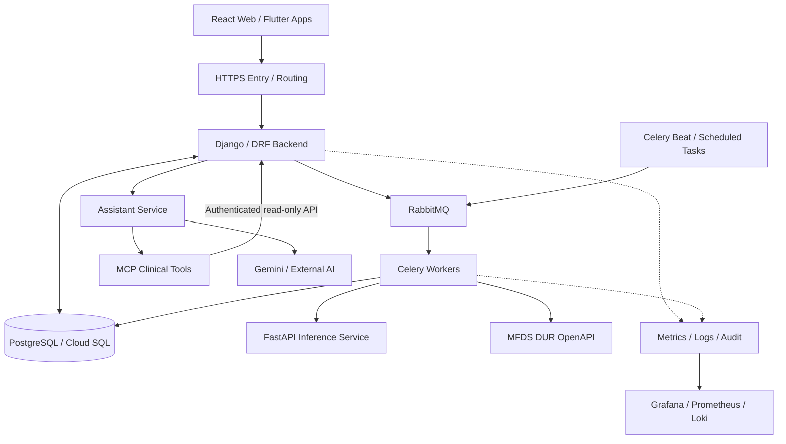

[← Portfolio Home](../README.md) · [Experience](./professional-experience.md) · [Technical Competencies](./technical-competencies.md) · [Projects & Contributions](./projects-contributions.md)

---

##  Featured Project

# BrainOn — AI-assisted Clinical Decision Support System

**AI 기반 뇌혈관질환 임상의사결정지원시스템(CDSS)**

BrainOn은 임상정보, 의료영상 AI 분석, 의약품 안전성 검사, AI Assistant를 하나의 진료 흐름으로 연결한 3인 팀 프로젝트입니다. Django Backend를 중심으로 각 서비스의 데이터를 연결하고, 비동기 작업·접근권한·데이터 정합성·운영 추적을 함께 고려했습니다.

| 항목 | 내용 |
| :--- | :--- |
| **기간** | 2026.08 – 2026.10 · 약 8주 개발 |
| **팀 구성** | 3명 · Backend / Frontend / AI |
| **담당** | Backend 개발, Database 설계·연동, AI 서비스 통합, Cloud Infrastructure 구성·배포, Observability, E2E 검증 |
| **주요 기술** | Python · Django/DRF · PostgreSQL · RabbitMQ/Celery · GCP · Docker · Grafana · Prometheus · Loki |
| **원본 저장소** | [brainCDSS/BrainCDSS — dev](https://github.com/brainCDSS/BrainCDSS/tree/dev) |

> **프로젝트에서 담당한 일**  
> 임상 API와 비동기 처리 구조를 구현하고, 데이터베이스·AI 연계·클라우드 배포 환경을 연결했습니다. 서비스 간 API 계약을 조율하면서 **통합·E2E 검증과 배포 작업을 수행**했고, 장애 원인을 HTTP 요청부터 작업 큐·서비스 로그까지 추적할 수 있도록 운영 체계를 구성했습니다.

## 01. Project Overview — 무엇을 해결하려 했는가

임상 Workflow에 필요한 환자·진료·영상·처방 데이터와 AI 분석 결과는 서로 다른 기능에서 생성됩니다. BrainOn에서는 이 데이터를 하나의 Backend Workflow로 연결하고, 처리 시간이 길거나 외부 의존성이 있는 작업을 별도 서비스로 분리했습니다.

- **임상 데이터 연결:** 환자·Encounter·영상검사·AI 분석·처방 간 데이터 관계와 상태 검증
- **의료 AI 연계:** Backend의 분석 요청을 비동기 작업으로 전달하고 결과·실패 상태를 관리
- **처방 안전성:** DUR 기준정보를 저장·동기화하고 Medication Safety·CDS Hooks에 연결
- **운영 관점:** 인증·권한, Audit, 요청 단위 추적, 지표·로그 기반의 장애 조사 경로 구성

## 02. System Architecture — 서비스 경계와 요청 흐름

아래 다이어그램은 **프로젝트의 논리적 서비스 흐름**입니다. Cloud Run·VM·Cloud SQL의 실제 배치와 접근 정책은 배포 시점의 설정에 따라 달라지므로 하나의 네트워크에 모두 위치한다는 의미는 아닙니다.

### 주요 설계 판단

| 설계 요소 | 적용한 이유 |
| :--- | :--- |
| **Django 중심의 Modular Monolith** | 임상 도메인별 API·Service 경계를 분리하면서 인증·권한·업무 상태를 일관되게 처리 |
| **RabbitMQ + Celery** | 추론·알림·기준정보 동기화 등 장시간 작업을 HTTP 요청 처리와 분리 |
| **PostgreSQL 중심의 상태 관리** | 임상 상태·작업 이력·Outbox 이벤트를 영속적으로 관리하고 참조 정합성 유지 |
| **Assistant / Inference 서비스 분리** | AI 기능은 독립 서비스로 실행하되 Backend의 인증된 경로·데이터 계약으로 연결 |
| **Observability / Audit 연결** | 요청·작업·오류를 같은 사건으로 추적할 수 있도록 식별자·로그·지표를 연결 |

설계 근거: [Django Modular Monolith ADR](https://github.com/brainCDSS/BrainCDSS/blob/dev/docs/decisions/ADR-001-modular-monolith.md) · [RabbitMQ / PostgreSQL ADR](https://github.com/brainCDSS/BrainCDSS/blob/dev/docs/decisions/ADR-003-rabbitmq-without-redis.md) · [MCP 접근 경계 ADR](https://github.com/brainCDSS/BrainCDSS/blob/dev/docs/decisions/ADR-004-mcp-through-backend-api.md)

## 03. My Engineering Contributions — 실제 구현과 담당 범위

기존의 여덟 가지 담당 영역을 유지하되, 기술 이름보다 **구현한 기능과 맡은 책임**을 중심으로 구분했습니다.

| Engineering Area | My Contribution |
| :--- | :--- |
| **Backend & Clinical Workflow** | Django/DRF REST API·비즈니스 로직, Imaging/DICOM·Surgical Planning, 임상 데이터 관계·상태·권한 검증 |
| **AI Assistant & MCP Integration** | Django Assistant Gateway·Internal MCP API, Assistant Service·MCP Tool 경로, 요청 Context·Scope·Trace 연계 |
| **Database & Data Integrity** | PostgreSQL 데이터 관계, 트랜잭션·행 잠금·Version 검증, 상태 전이·Audit 구조 |
| **Asynchronous Processing & Automation** | RabbitMQ/Celery Queue·Worker·Beat, Outbox·정기 작업·실패/재시도 경로 및 알림 연계 |
| **Clinical Safety & External Integration** | 식약처 DUR OpenAPI, 기준정보 Local DB 저장·동기화, Medication Safety·CDS Hooks 연계 |
| **Cloud Infrastructure & Deployment** | GCP VPC·Cloud Run·Cloud SQL·VM·Docker 환경 구성, 네트워크·DB·외부 API 연결 및 배포·점검 |
| **Observability & Traceability** | Grafana·Prometheus·Loki·Alloy, Dashboard, `request_id`·AuditLog·오류 Tracking Code |
| **System Integration & Quality** | Frontend·Backend·AI 간 API 계약, Git 병합·충돌 해결, 서비스 통합·E2E 검증과 트러블슈팅 |

### 03.1 Clinical Backend & Data Integrity

- **Imaging API:** 검사 처방·Study·History·Viewer Session API, Serializer·Permission·Selector·Service 계층 구성. DICOM·Orthanc 연계 인터페이스를 구현했습니다.
- **Surgical Planning:** 계획·Clip·협업 메시지 API, 환자·진료·영상·AI 분석의 참조 관계 검증. 확정·취소 상태 수정 제한과 Version 기반 동시성 제어를 적용했습니다.
- **정합성 관리:** `transaction.atomic()`, `select_for_update()` 및 Version 검증으로 다중 데이터 변경과 중복 생성·동시 수정 조건을 관리했습니다.
- **API Routing:** 실제 구현한 API가 Generated/Fallback API보다 먼저 처리되도록 URL 등록 순서를 정리했습니다.

코드: [Imaging API](https://github.com/brainCDSS/BrainCDSS/tree/dev/backend/apps/imaging/api) · [Surgical Planning Service](https://github.com/brainCDSS/BrainCDSS/blob/dev/backend/apps/surgical_planning/services/planning.py) · [직접 작성한 구현 Commit](https://github.com/brainCDSS/BrainCDSS/commit/4936efd42bf8e118b1e2c7bc3aeb70c9811a82e2)

### 03.2 Medication Safety & External DUR Integration

- **식약처 DUR 연동:** 외부 API 응답을 Local DB 기준정보로 저장하고 동기화 관리 Command·Service·Task를 구성했습니다.
- **검사 흐름:** Medication Master/성분 매핑을 기반으로 처방정보와 DUR Rule을 연결하고, Medication Safety 결과를 CDS Hooks 경로로 제공하도록 구현했습니다.
- **검사 규칙 지원:** DDI·DOSE·DUPLICATE·AGE·ELDERLY·PREGNANCY·DURATION·ALLERGY 검사 경로를 구성했습니다.
- **검증 범위 구분:** 실제 OpenAPI 수집·응답이 확인된 기준정보는 **병용금기(DDI)와 용량주의(DOSE)**입니다. 다른 규칙은 모델·검사 경로의 구현과 실제 운영 기준정보 검증을 구분해 설명합니다.

코드: [Medication Safety](https://github.com/brainCDSS/BrainCDSS/tree/dev/backend/apps/medication_safety) · [DUR 동기화 Task](https://github.com/brainCDSS/BrainCDSS/blob/dev/backend/apps/medication_safety/tasks/dur_sync.py) · [PR #35](https://github.com/brainCDSS/BrainCDSS/pull/35)

### 03.3 Async Processing, AI Inference & Assistant/MCP

- **RabbitMQ/Celery:** AI 추론·알림·외부 연동 작업을 HTTP 요청과 분리하고, Worker·Beat와 작업 유형별 Queue Routing을 구성했습니다.
- **작업 상태 관리:** AI 분석의 `QUEUED`·`PROCESSING`·`RETRYING`·`COMPLETED`·`FAILED` 상태, Attempt 이력, 실패 코드 및 결과 저장 경로를 연계했습니다.
- **Outbox / Scheduled Tasks:** 이벤트 발행·실패 재시도 경로, 주기적인 알림 및 DUR 기준정보 동기화 작업을 연결했습니다.
- **AI Assistant / MCP:** 인증된 사용자의 Actor·Role·Patient Scope를 Django에서 구성해 Assistant와 MCP로 전달했습니다. 환자별 조회 Tool과 전체 업무 현황 Tool을 분리하고 접근 범위를 검사했습니다.
- **AI 서비스 통합:** FastAPI 기반 추론 서비스 요청·결과 처리와 Cloud Run 추론 연계, FCM Web/Mobile 알림 변경사항의 팀 통합을 수행했습니다.

코드: [Assistant Gateway](https://github.com/brainCDSS/BrainCDSS/blob/dev/backend/apps/assistant/api/chat.py) · [MCP Registry](https://github.com/brainCDSS/BrainCDSS/blob/dev/mcp-server/src/tools/registry.py) · [AI/MCP 직접 작성 Commit](https://github.com/brainCDSS/BrainCDSS/commit/a5460a939bcd73243b0a35377b2ba46ecff86ee9) · [PR #36](https://github.com/brainCDSS/BrainCDSS/pull/36)

### 03.4 Cloud Infrastructure, Deployment & Observability

- **배포·네트워크:** Cloud Run·Compute Engine VM·Cloud SQL(PostgreSQL)·Docker 환경을 구성하고 Backend/Worker/DB/외부 서비스 간 연결 경로를 점검했습니다. VPC Private IP, 서비스 접근 조건 및 외부 API Egress를 구분해 검증했습니다.
- **운영 모니터링:** Backend HTTP·Celery·RabbitMQ·DB·AI 분석 관련 지표와 Docker 로그 수집 경로를 구성했습니다. Grafana Dashboard·Data Source와 Prometheus·Alloy·Loki 연계를 작업했습니다.
- **요청 추적:** HTTP 요청에 `request_id`를 부여·전달하고 AuditLog, 비동기 작업, 구조화 로그를 연결했습니다. 사용자용 `ERR-` Tracking Code와 내부 UUID를 분리했습니다.
- **부분 실패 감지:** HTTP `2xx` 응답 안에 포함된 하위 서비스 `FAILED`·`TIMEOUT`·`DEGRADED` 상태를 별도 운영 신호로 구분하는 로직을 구현했습니다.
- **통합·배포 후 점검:** 서비스 설정·API 계약·실행 경로를 대조하고 E2E 검증과 배포 후 연계 점검을 수행했습니다.

코드: [Grafana Dashboards](https://github.com/brainCDSS/BrainCDSS/tree/dev/infra/observability/grafana/dashboards) · [Operations Monitoring Commit](https://github.com/brainCDSS/BrainCDSS/commit/c54a26ddf0d123b52ae427902684b332005059a6) · [Audit & Tracking Commit](https://github.com/brainCDSS/BrainCDSS/commit/4a9e70ece4b55258cab8541f555f3173bc829f53)

## 04. Engineering Challenges — 문제를 분석하고 해결한 과정

기능별 구현 목록과 별도로, 실제 개발·통합 과정에서 작업 판단이 필요했던 사례를 정리했습니다.

<strong>Case 01 · Surgical Planning 병합 충돌과 API Routing</strong>

**상황** — `dev` 변경사항을 통합하면서 Surgical Planning의 Permission·Serializer·View·Service 및 `config/urls.py`에 충돌이 발생했습니다. Generated API와 실제 구현 API의 경로 우선순위도 점검해야 했습니다.

**대응** — 변경 파일별 차이를 비교하고 검증한 Backend 구현을 기준으로 병합했습니다. 실제 API가 우선하도록 URL Routing을 조정한 뒤 Django Check·Migration 검사와 관련 회귀 테스트를 수행했습니다.

**결과** — 충돌 해결 및 `dev` 병합을 마쳤고, PR #35에 Medication Safety 관련 **15개 Regression Test PASS**와 MEDM E2E 검증을 기록했습니다. 이 테스트는 병합 후 전체 시스템의 모든 기능을 검증했다는 의미는 아닙니다.

**근거** — [PR #35](https://github.com/brainCDSS/BrainCDSS/pull/35) · [Surgical Planning Commit](https://github.com/brainCDSS/BrainCDSS/commit/4936efd42bf8e118b1e2c7bc3aeb70c9811a82e2)

<strong>Case 02 · MCP의 환자별 Context와 전체 업무 조회 분리</strong>

**상황** — 초기 Assistant 흐름에서 환자 Context를 전제로 해 일반 질문이나 전체 업무 현황 조회에도 환자 선택이 필요했습니다.

**대응** — 질문 유형별 Tool Routing을 분리하고, 환자 정보 조회에는 Patient Scope를, 전체 업무 조회에는 역할별 접근 조건을 적용했습니다. 임상 데이터는 MCP가 DB를 직접 조회하지 않고 Django Internal API를 통해 접근하도록 구성했습니다.

**결과** — 환자별 조회와 환자 미선택 조회의 입력·권한 조건을 분리하고 관련 테스트 코드를 추가했습니다.

**근거** — [MCP Context & Routing Commit](https://github.com/brainCDSS/BrainCDSS/commit/a5460a939bcd73243b0a35377b2ba46ecff86ee9)

<strong>Case 03 · 사용자 오류 표시와 내부 요청 추적의 분리</strong>

**상황** — 내부 요청 UUID는 운영 로그 검색에 필요하지만, 오류가 발생한 사용자에게 그대로 보여주기에는 복잡했습니다.

**대응** — 내부 `request_id`를 유지하고, 사용자에게는 `ERR-` 형식의 Tracking Code를 노출하도록 오류 응답·Middleware·Audit 조회 흐름을 연결했습니다.

**결과** — 사용자 화면의 오류 코드에서 내부 요청·Audit 정보까지 조사할 수 있는 코드 경로를 구현했습니다.

**근거** — [Audit / Error Tracking Commit](https://github.com/brainCDSS/BrainCDSS/commit/4a9e70ece4b55258cab8541f555f3173bc829f53)

<strong>Case 04 · VPC와 서비스 간 통신 경로 점검</strong>

**상황** — Cloud Run·VM·Cloud SQL·추론 서비스가 다른 환경에서 실행되어 네트워크 경로와 권한 설정을 함께 확인해야 했습니다.

**대응** — 서비스별 VPC Egress, Private IP, Cloud SQL 연결, 외부 API 호출 경로, 인증·포트 설정을 분리해 점검했습니다.

**확인 범위** — 구성별 연결 조건과 점검 경로를 정리하고 배포·연계 검증에 반영했습니다. 이 항목은 모든 환경에서 통신 문제가 완전히 해소되었다는 주장과 구분합니다.

**관련 코드·설정** — [GCP Infra](https://github.com/brainCDSS/BrainCDSS/tree/dev/infra/gcp) · [Cloud Run Inference Guide](https://github.com/brainCDSS/BrainCDSS/blob/dev/docs/INFERENCE_CLOUD_RUN_DEPLOYMENT.md)

## 05. Validation & Results — 검증 기록

검증 성과는 작업 당시의 PR 기록과 직접 수행한 통합 점검 범위를 기준으로 작성했습니다.

| 검증 항목 | 확인된 결과·범위 | 근거 |
| :--- | :--- | :--- |
| **Backend 기본 검증** | `python manage.py check`, Migration 누락 검사 정상 | [PR #35](https://github.com/brainCDSS/BrainCDSS/pull/35) |
| **Medication Safety** | 관련 Regression Test **15개 PASS** | [PR #35](https://github.com/brainCDSS/BrainCDSS/pull/35) |
| **DUR / E2E** | 기준정보 응답·DB 저장·규칙 활성화, MEDM → Safety 연계 확인 | [PR #35](https://github.com/brainCDSS/BrainCDSS/pull/35) |
| **투여기간 경계 검사** | 허용 기간 정상 / 초과 시 `DURATION / MAJOR` Alert 확인 | [PR #35](https://github.com/brainCDSS/BrainCDSS/pull/35) |
| **Assistant / Inference 통합** | Django Check, Frontend Test·Build, Compose Config 검사 기록 | [PR #36](https://github.com/brainCDSS/BrainCDSS/pull/36) |
| **배포·서비스 연계** | Cloud 환경 구성·배포·서비스 간 API/E2E 흐름 점검 수행 | [원본 저장소](https://github.com/brainCDSS/BrainCDSS/tree/dev) |

**검증 결과의 의미:** 위 표는 해당 PR 시점의 구현·통합 기록입니다. 전체 서비스의 현재 실시간 가용성, 의료 AI 모델의 정확도, 모든 외부 연동의 운영 성공률을 나타내는 수치는 아닙니다.

## 06. Selected Code Contributions — 직접 작성한 증빙

아래 PR 두 건과 네 개 커밋은 `choi-creator98`의 작성 기록을 기준으로 선정했습니다. 팀 전체의 결과물과 개인 코드 기여를 구분해 확인할 수 있습니다.

| 구분 | 코드 / 검증 자료 |
| :--- | :--- |
| **Clinical Backend · DUR · Imaging · Surgical Planning** | [Merged PR #35](https://github.com/brainCDSS/BrainCDSS/pull/35) |
| **Assistant · MCP · Cloud Run Inference** | [Merged PR #36](https://github.com/brainCDSS/BrainCDSS/pull/36) |
| **Imaging / Surgical Planning API** | [Implementation Commit](https://github.com/brainCDSS/BrainCDSS/commit/4936efd42bf8e118b1e2c7bc3aeb70c9811a82e2) |
| **Assistant / MCP Context & Routing** | [Implementation Commit](https://github.com/brainCDSS/BrainCDSS/commit/a5460a939bcd73243b0a35377b2ba46ecff86ee9) |
| **Observability · Grafana Dashboards** | [Implementation Commit](https://github.com/brainCDSS/BrainCDSS/commit/c54a26ddf0d123b52ae427902684b332005059a6) |
| **AuditLog · Error Tracking** | [Implementation Commit](https://github.com/brainCDSS/BrainCDSS/commit/4a9e70ece4b55258cab8541f555f3173bc829f53) |

## 07. Visual Evidence & Technical Documentation

포트폴리오 화면에는 가능한 한 **실제 프로젝트의 비식별화된 캡처**를 사용합니다. 기능을 설명하는 일반적인 AI 생성 이미지는 실제 구현 증빙으로 사용하지 않습니다.

권장 자료는 다음과 같습니다.

1. **Clinical Workflow:** 의료진 대시보드 또는 영상·처방 흐름 화면 — 사용자 관점의 서비스 범위 확인
2. **Cloud / Architecture:** 실제 배포 아키텍처 다이어그램 — 서비스 진입점과 데이터·작업 경계 설명
3. **Observability:** Grafana 대시보드 캡처 — API·Queue·AI·DB 운영 지표 확인
4. **E2E / Verification:** 실제 테스트 결과 또는 CI·PR 검증 화면 — 구현 내용과 검증 근거 연결

<!-- 실제 캡처 파일을 assets 폴더에 업로드한 후 아래 형식으로 추가합니다. -->
<!--  -->
<!--  -->

추가 설계·구현 문서: [Architecture Decisions](https://github.com/brainCDSS/BrainCDSS/tree/dev/docs/decisions) · [RabbitMQ/Celery Queue Layout](https://github.com/brainCDSS/BrainCDSS/blob/dev/docs/CELERY_RABBITMQ_QUEUES.md) · [MCP Architecture](https://github.com/brainCDSS/BrainCDSS/blob/dev/docs/architecture/ai-assistant-and-mcp.md) · [Observability Configuration](https://github.com/brainCDSS/BrainCDSS/tree/dev/infra/observability)

---

[← 메인 포트폴리오로 돌아가기](../README.md) · [원본 팀 저장소](https://github.com/brainCDSS/BrainCDSS/tree/dev)
