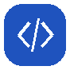

[← Portfolio Home](../README.md) · [Featured Project](./featured-project.md) · [Experience](./professional-experience.md) · [Technical Competencies](./technical-competencies.md) · [Projects & Contributions](./projects-contributions.md)

---

##  Featured Project

### BrainOn — AI-assisted Clinical Decision Support System

**AI 기반 뇌혈관질환 임상의사결정지원시스템(CDSS)**

- 임상 Workflow, 의료영상 AI 분석, AI Assistant 및 의약품 안전성 검증을 통합한 의료 AI 서비스 개발 팀 프로젝트
- **Period:** Aug 2026 – Oct 2026
- **Team:** 3 Members
- **My Role:** Backend Engineering · AI Service Integration · Database · Cloud Infrastructure · Operations

<strong>Key Engineering Contributions</strong>

<table>
  <tr>
    <td width="31%" valign="top"> <strong>Backend & Clinical Workflow</strong></td>
    <td valign="top">— Django/DRF 기반 REST API 및 임상 비즈니스 로직 구현, Imaging/DICOM·Surgical Planning 등 임상 도메인 API 개발 및 연계</td>
  </tr>
  <tr>
    <td valign="top"> <strong>AI Assistant & MCP Integration</strong></td>
    <td valign="top">— Django Assistant Gateway·Assistant Service·MCP Server 연계, Vertex AI Gemini 기반 임상정보 조회 기능 및 AI 추론 서비스 연동</td>
  </tr>
  <tr>
    <td valign="top"> <strong>Database & Data Integrity</strong></td>
    <td valign="top">— PostgreSQL 데이터 모델 설계 및 Cloud SQL 연동, 데이터 정합성·트랜잭션·상태 및 버전 관리 구조 구현</td>
  </tr>
  <tr>
    <td valign="top"> <strong>Asynchronous Processing & Automation</strong></td>
    <td valign="top">— RabbitMQ/Celery 기반 비동기 작업 처리, Worker/Beat·Scheduled Task 구성 및 FCM 알림 기능 연계</td>
  </tr>
  <tr>
    <td valign="top"> <strong>Clinical Safety & External Integration</strong></td>
    <td valign="top">— DUR OpenAPI 연동, Medication Safety 검사 및 CDS Hooks 기반 임상 의사결정 지원 기능 구현</td>
  </tr>
  <tr>
    <td valign="top"> <strong>Cloud Infrastructure & Deployment</strong></td>
    <td valign="top">— GCP VPC·Cloud Run·Cloud SQL·VM 기반 서비스 환경 구성, 내부 네트워크·외부 API 통신·배포 및 운영 환경 관리</td>
  </tr>
  <tr>
    <td valign="top"> <strong>Observability & Traceability</strong></td>
    <td valign="top">— Grafana·Prometheus·Loki 기반 모니터링 구축, request_id·AuditLog 기반 요청 추적 및 장애 분석 체계 구현</td>
  </tr>
  <tr>
    <td valign="top"> <strong>System Integration & Quality</strong></td>
    <td valign="top">— Frontend·Backend·AI 서비스 간 API 계약 및 통합, E2E 검증·트러블슈팅·Git 브랜치 병합 및 충돌 해결</td>
  </tr>
</table>

#### Selected Code Contributions

- [DUR, Medication Safety, Imaging & Surgical Planning](https://github.com/brainCDSS/BrainCDSS/pull/35)
- [AI Assistant, MCP & Cloud Run Inference Integration](https://github.com/brainCDSS/BrainCDSS/pull/36)
- [Operations Monitoring & Error Tracing](https://github.com/brainCDSS/BrainCDSS/commit/c54a26ddf0d123b52ae427902684b332005059a6)
- [Audit Request Tracking](https://github.com/brainCDSS/BrainCDSS/commit/4a9e70ece4b55258cab8541f555f3173bc829f53)

**[View BrainOn Project Repository](https://github.com/brainCDSS/BrainCDSS/tree/dev)**

---

---

[← 메인 포트폴리오로 돌아가기](../README.md)
