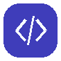
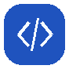
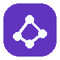
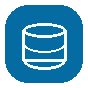
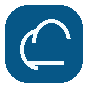
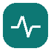
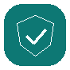
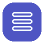

[← Portfolio Home](../README.md) · [Featured Project](./featured-project.md) · [Experience](./professional-experience.md) · [Technical Competencies](./technical-competencies.md) · [Projects & Contributions](./projects-contributions.md)

---

##  Technical Competencies

| Engineering Area | Technologies & Competencies |
| :--- | :--- |
|  **Backend Engineering** | Python · Django · DRF · REST API · Business Logic · API Design |
|  **AI Service Integration** | MCP · Vertex AI Gemini · AI Assistant · AI Inference Service Integration |
|  **Database & Data Management** | PostgreSQL · Cloud SQL · Data Modeling · Transactions · Data Integrity |
|  **Asynchronous Processing** | RabbitMQ · Celery · Worker/Beat · Task Scheduling · Automation |
|  **Cloud & Infrastructure** | GCP · VPC · Cloud Run · Cloud SQL · Cloud NAT · Load Balancing · Docker · Linux |
|  **Observability & Monitoring** | Grafana · Prometheus · Loki · Alloy · Zabbix · Structured Logging |
|  **Security & Operations** | JWT · RBAC · AuditLog · Request Tracing · Windows/Linux Server · Network/Firewall · Backup & Recovery · Endpoint Management |
|  **Development & Collaboration** | Git · GitHub · CI/CD · API Integration · E2E Testing · Troubleshooting |

---

---

[← 메인 포트폴리오로 돌아가기](../README.md)
